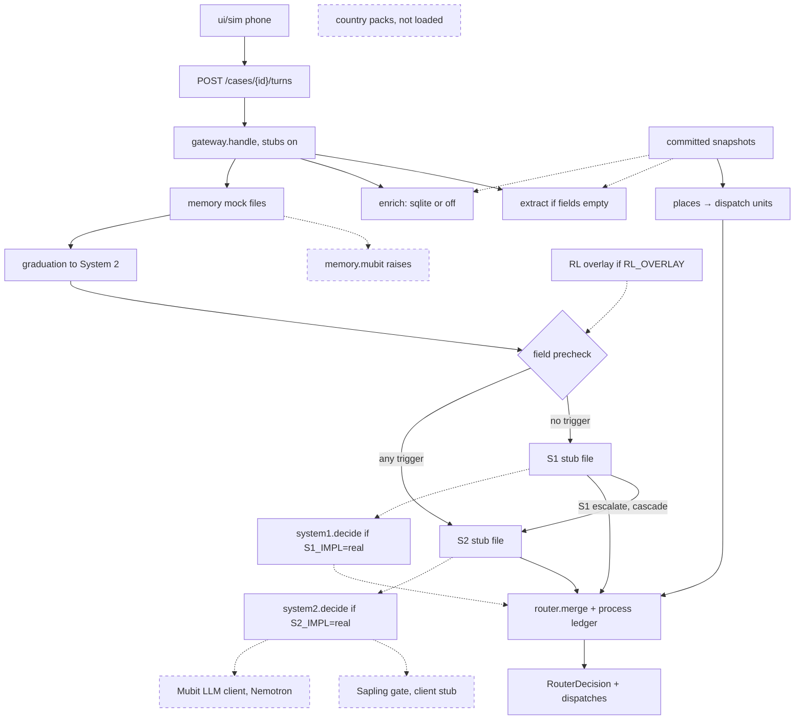
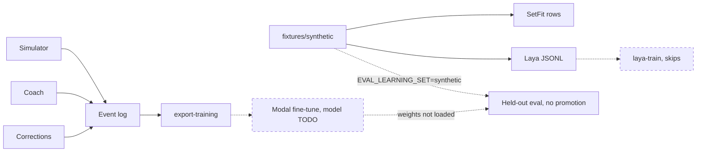
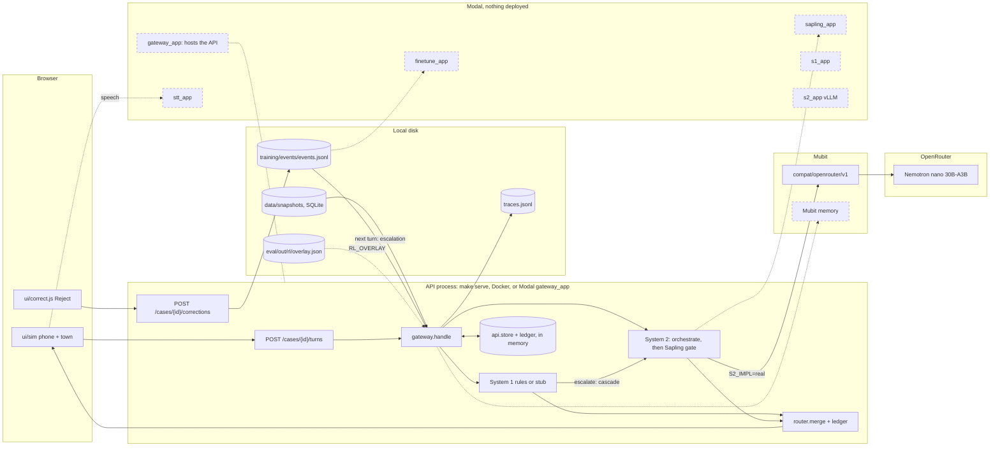

# BaanSafe — Revised Architecture (from Moly, 24 Oct 2026 ~03:00 UK)

This file is the repo copy of that revision. The code follows it. It is not a product decision, and it does not set any value in `config/decisions.yaml`.

Key corrections:

- Mubit Gateway owns: authenticated API gateway, memory retrieval (similar cases, prior failures, policies, corrections), policy and safeguarding checks, routing to System 1 or System 2, tracing/versioning/latency/token/audit, and a validated structured response. Routing mode is `cascade`: a System 1 escalate continues to System 2 in the same turn. Mubit does not reason.
- No separate BaanSafe memory-retrieval service in front of Mubit. The call agent sends the live case to Mubit. Mubit retrieves memory and provides it to whichever system handles the case.
- System 1 is a separate fast deterministic system (rules, keyword or field extraction, priority rules, simple routing, duplicate checks, fast evidence-gap detection). Its outcome is `fast_route`. It never handles ambiguous or high-risk cases.
- System 2 is a separate deliberative system orchestrated by Nemotron (evidence synthesis, ambiguity, medical dependency, safeguarding, complex routing, aid exceptions, correction proposals and root cause). Its outcome is `reasoned_recommendation`. It never handles routine low-risk cases.
- Nemotron is the System 2 orchestrator. It is not embedded in Mubit. Mubit calls Nemotron when System 2 is required. Nemotron returns the result to Mubit for policy validation, tracing, and the memory write.
- Banyan Sapling (`MubitLabs/banyan-sapling`, Apache-2.0, about 23B stored parameters) verifies System 2 claims after that reasoning and before the Decision Router. It runs only for aid eligibility and denials. System 1 does not call it. The input is a policy, evidence, and a claim, capped at 16,384 tokens. `supported` lets the proposed action stand. `violation` blocks it. `unsure`, `missing` (the checkpoint label `insufficient_information`), and `contradicted` (the checkpoint label `inconsistent_context`) hand the case to a human. The committed client is a stub. Hosting, the 48GB-class GPU, and whether Thai is translated first stay `TODO_HUMAN` in `config/decisions.yaml`.
- The Decision Router merges the deciding outcome (System 2 after a cascade), applies final policy and safeguarding, requires human review when needed, and returns one of `ask_next_question`, `create_provisional_dispatch`, `escalate_to_supervisor`, `finalize_case`, or `request_more_evidence`. `source_outcomes` lists the deciding outcome first, then priors.
- Every System 1 outcome and every System 2 outcome is recorded separately. Humans keep authority over denials, safeguarding exceptions, and irreversible actions.

Target flow: Caller → live speech-to-text → Call Agent → Mubit Gateway (memory retrieval, policy pre-check, route) → System 1 (simple, clear, low-risk) or System 2 (ambiguous or high-risk, Nemotron, then Sapling when the claim is aid eligibility or a denial) → Decision Router → Call Agent (next question, update case, or provisional dispatch).

The diagram is `gateway/route.py` on the default request (`use_stubs=True`). Solid edges run. A dashed node is not called on that request. After mock memory, `gateway/graduation.py` may tag `complex_situation` and add a `graduated-*` recommendation. That sets no priority and does not move a pattern into System 1. The field precheck in `gateway/chooser.py` picks the system. `router/merge.py` builds the `RouterDecision` and `router/ledger.py` reserves stock in this process only. `load_dispatch_resources` reads `data/snapshots/places.json` on that request and lists public shelters, hospitals, and boat points ahead of the fictional units. Extract reads `data/snapshots/gazetteer.json` only when it runs. Enrichment reads the Open-Meteo and RID snapshots only when SQLite is present, and those flags do not change `final_priority`. GISTDA, TMD, and geoBoundaries stay in `data/snapshots` and are not read on the turn. `countries/` is not imported. `system1/decide.py` runs only when `S1_IMPL=real` or `use_stubs=False`, and then it replaces the stub file. `system2.decide` runs only when `S2_IMPL=real` or `use_stubs=False`. The model id is `nvidia/nemotron-3-nano-30b-a3b`. The default request and `infra/modal/gateway_app.py` keep `S2_IMPL=stub`, so Nemotron is not called. `llm/client.py` and `llm/openai_client.py` accept only a Mubit host (`llm.provider_route` is `mubit`, including the compat OpenRouter prefix). `GET /policies` serves the local corpus on its own. Aid routes return 501. Modal model apps refuse to start while their model and GPU values are `TODO_HUMAN`. The gateway app does not.

Training is a separate path from that call. Operator corrections, coach notes, and simulator outcomes append one `TrainingEvent` each. `make export-training` reads the log. `fixtures/synthetic` is a seeded flood-call set. `training/synthetic_export.py` writes SetFit rows from it (`SYNTHETIC=1` on that make target). `training/laya_export.py` writes Laya JSONL. `scripts/laya_train.py` skips unless `LAYA_TRAIN=1`, a GPU or a Modal task is present, and `laya-train` is on `PATH`. The Modal fine-tune job takes one event-log dataset per task and does not start while its base model is `TODO_HUMAN`. It does not read the synthetic rows. Held-out eval splits on `group_id` and filters `source`. It scores stub arms and does not load fine-tune weights. `EVAL_LEARNING_SET=synthetic` scores that call set on its committed group split and still does not promote.

`ui/correct.js` posts a human correction with `task` and `input_ref` already filled. `sim/coach.py` appends `source=coach` and `source=sim`. The log is `training/events` via `training/log.py`. `training/export.py` writes `s1`, `s2`, `sapling`, and `prefs`, each with a manifest. `infra/modal/finetune_job.py` trains `s1_triage` with SetFit and the other tasks with LoRA. `eval/learning` scores held-out groups: arm C keeps `source=human`, and `C_coach` also keeps `source=coach`. Nothing in this path promotes a weight into System 1.

Parallel workstreams during a call feed Mubit: evidence extraction (location, people, danger, medical), policy and safety, Mubit memory retrieval, and resource status (boats, ambulances, shelters).

## Routing in detail

Checked against `main` on 24 October 2026. This section says where each step runs: the browser, the API process, Mubit, OpenRouter, Modal, or local disk.

### Where things run

"Mubit Gateway" in the diagrams above is the `gateway/` package. It runs inside the BaanSafe API process, not on Mubit. The Mubit service is reached for one thing today: the System 2 model call. Mubit memory (`memory/mubit.py`) raises until `memory.mubit_project`, `memory.retrieval_top_k`, and `memory.token_budget` are set.

| Place | What runs there | State it holds |
|---|---|---|
| Browser | `ui/sim/` town and phone, `ui/correct.js` | None that the backend reads |
| API process (`api/main.py`) | FastAPI routes, `gateway/`, `system1/`, `system2/`, `router/`, `policies/`, `memory/adapter.py` in mock mode | Cases in `api/store.py` and stock holds in `router/ledger.py`, both in memory. Both reset on restart, and each container has its own copy |
| Mubit (`api.mubit.ai/compat/openrouter/v1`) | The LLM hop for System 2. `llm/client.py` refuses any other host | Mubit-side traces. The repo does not read them |
| OpenRouter, behind Mubit | `nvidia/nemotron-3-nano-30b-a3b` (`system2.orchestrator_model`). Its provider key is in the Mubit console, not in the repo or Modal | Account credit and the free-tier counter |
| Modal | Six apps in `infra/modal/`. None is deployed (`modal app list` is empty) | Secrets `baansafe-hf` (`HF_TOKEN`) and `baansafe-mubit` (`MUBIT_API_KEY`, `MUBIT_BASE_URL`), plus volumes once an app runs |
| Local disk | `traces.jsonl` (`TRACE_PATH`), `training/events/events.jsonl` (`TRAINING_EVENTS_PATH`), the mock corrections JSONL, `data/processed` SQLite, `data/snapshots/`, `eval/out/` | Everything that survives a restart |

The API process is the same code in three hosts: `make serve` on a laptop, `docker/Dockerfile` (`make docker-build`), or `infra/modal/gateway_app.py` on Modal. All three default to `S1_IMPL=stub`, `S2_IMPL=stub`, and `MEMORY_IMPL=mock`. The local `.env` sets `S1_IMPL=real`.

### One turn, step by step

Each step names its file and where it runs. Everything runs in the API process unless a step says otherwise.

1. **Phone (browser).** `ui/sim/sim.js` `runPlaceCall` sends `POST /cases` with a `fixture_id`, then `POST /cases/{id}/turns` with the caller's line. It sends the fixture id, so extract does not see the spoken sentence. That is PRD open item 6. A case created with a `transcript` and no `fields` does get extracted.
2. **Append the turn.** `api/routes/endpoints.py` `add_turn` appends the line to the stored `CaseState` and calls `execute`, which calls `gateway.route.handle(case, use_stubs=True)`.
3. **Extract.** `gateway/route.py` `_extract` runs `system1/extract.py` `extract` when the case has no fields, and again on every later turn once `keyword_extraction` is in `policy_flags`. Fixture cases carry hand-filled fields and are never extracted. The district match reads SQLite when present, then `data/snapshots/gazetteer.json`.
4. **Enrich.** `enrich/context.py` `location_context` adds data flags from SQLite (Open-Meteo, RID) when `ENRICH_IMPL=data`. The flags never change priority.
5. **Memory.** `memory/adapter.py` `retrieve`. `MEMORY_IMPL=mock` reads `mocks/memory_context/`. `MEMORY_IMPL=mubit` calls `memory/mubit.py`, which raises.
6. **Human-correction escalation.** `gateway/graduation.py` `apply` reads the training event log. The result is cached per log version. When at least `correction_loop.escalation_threshold` (2) distinct cases carry a human `s1_triage` correction with a `graduation_labels` label on this `(needs, vulnerable, danger)` pattern, it adds `complex_situation` and a `graduated-*` correction MemoryItem. It sets no priority.
7. **Choose the entry system.** `gateway/chooser.py` `choose`. Any `route_to_system_2_if_any` trigger in `config/escalation.yaml` sends the case to System 2: medical, oxygen_dependent or immobile, location confidence below 0.7 or missing, a safeguarding, conflicting_evidence, aid_exception, or complex_situation flag, or a rescue, medical, or aid_payment need. With `RL_OVERLAY` set, a demoted coarse signature adds `learned:demoted`. No trigger sends the case to System 1. The gateway trace event records the mode, the system, and the triggers.
8. **System 1.**
   - With stubs, the stub file for that case id answers. A non-fixture id gets the no-stub fallback (`missing_evidence == ["fixture_stub"]`).
   - With `S1_IMPL=real`, `system1/decide.py` `decide(case, overlay)` runs the needs table (P2–P4, never P1).
   - It escalates when location confidence is below `system_1_min_confidence` (0.80) or a trigger is present, as defence in depth.
   - A graduated narrow signature in the overlay can answer instead, as a learned System 1 rule.
9. **Cascade (at most once per turn).** With `routing.yaml` `mode: cascade`, a System 1 outcome with `escalate=true` runs System 2 in the same turn. System 2 gets the System 1 outcome as `handoff`, plus the overlay's recommendation for the narrow signature. The no-stub fallback never cascades. Nothing loops back to System 1.
10. **System 2.**
    - With stubs, the stub file answers.
    - With `S2_IMPL=real`, `system2/decide.py` calls `system2/orchestrator.py` `orchestrate`. That builds the prompt from the transcript, fields, flags, fired triggers, memory, resource counts, handoff, and recommendation. It calls `llm/client.py` `complete`, which posts to **Mubit**, and Mubit forwards to **OpenRouter** and Nemotron nano. The call uses `max_tokens` 700, `reasoning` off, temperature 0, seed 7, and a 10 s timeout (`system2.max_latency_ms`).
    - The reply is parsed into `reasoned_recommendation`.
    - A timeout, an HTTP error (429 is named "rate limited"), an empty reply, or a parse failure becomes a `system2_unavailable` escalation. That escalation is P1 for medical, oxygen_dependent, need:rescue, or immobile, and P2 otherwise.
    - `_post_rules` forces `requires_human` on safeguarding and aid cases.
11. **Sapling gate.** `system2/sapling.py` `verify_before_router` runs only on a System 2 outcome whose check is `aid_eligibility` or `denial` (`system2.sapling_scope`). The client is the stub in `mocks/sapling_stub/`. A live Sapling would run on Modal (`sapling_app`) and is blocked by four `sapling.*` decisions.
12. **Decision Router.** `router/merge.py` `merge(case, outcome, notes, resources, prior)` picks the next action, fans out provisional dispatches, and reserves units in `router/ledger.py` (in memory). `load_dispatch_resources` lists the places snapshot before the four fictional units in `mocks/resources.json`. `source_outcomes` is `[deciding, *prior]`. A router trace event is written.
13. **Back to the phone (browser).** The `RouterDecision` returns in `TurnResult`. `next_action` `ask_next_question` makes the phone ask `next_question`, and the caller's answer is the next turn. That is the conversation loop.

### The loops

| Loop | Trigger | Path | Where | Closes when |
|---|---|---|---|---|
| L1 Conversation | Every caller line | Steps 1–13, then the next `POST /turns` | Browser, then the API process | `finalize_case`, `escalate_to_supervisor`, or a dispatch |
| L2 Cascade | System 1 `escalate=true` | System 1, then System 2 in the same turn, at most once | API process, plus Mubit and OpenRouter when `S2_IMPL=real` | The same turn |
| L3 Human correction to escalation | Operator Reject in `ui/correct.js` | `POST /cases/{id}/corrections`: `memory.store_correction` (mock JSONL) and `training/log.append_event`. On the next turn, step 6 counts the events | Browser, API process, local disk | The next turn after the second distinct case. Live, no training |
| L4 RL loop | `make rl-loop` (live) or `make rl-loop-replay` | `eval/rl/run.py` runs authored themes through `gateway.handle(overlay=...)`. The S2 modes are `live` (Mubit, 2/4/8 s 429 backoff, replies cached in `s2_cache.jsonl`) and `replay` (cache only). `eval/rl/reward.py` scores each episode against settled truth. `eval/rl/learner.py` graduates, recommends, and demotes, and the shadow bandit only records. The run writes `overlay.json`, `run.json`, and sim TrainingEvents | Laptop, then Mubit and OpenRouter in live mode | Offline. It reaches the live path only when `RL_OVERLAY` names `overlay.json` |
| L5 Training export to fine-tune | `make export-training` | The event log becomes per-task datasets (`s1`, `s2`, `sapling`, `prefs`). `infra/modal/finetune_app.py` would train SetFit for `s1_triage` and LoRA for the others | Laptop, then Modal | Not closed: the base model is `TODO_HUMAN`, and no trained weight is loaded or promoted |
| L6 Caller sim and coach | `make sim-eval` | `sim/env.py` and `sim/coach.py` append `source=sim` and `source=coach` events | Laptop | Feeds L5. The coach source counts in eval arm `C_coach` only |

A pattern's path through the loops: a System 1 under-triage is corrected by a human (L3). From the second distinct case on, that pattern goes to System 2. The RL loop (L4) can demote a coarse pattern to System 2 after one under-triage. It can graduate a narrow pattern into a System 1 rule after `correction_loop.graduation_threshold` (2) matching System 2 decisions, but only for low-confidence handoffs and never for P1 or complex cases. A human escalation (L3) always wins over a learned System 1 rule (L4), because `complex_situation` forces a System 2 entry at step 7, and System 1 never sees the case.

### Modal: what needs it and what it waits on

| App | Needed for | Blocked by | Status |
|---|---|---|---|
| `gateway_app` | A public URL for the town and the API | Nothing. `make deploy-modal` | Not deployed. It attaches no secret, so it cannot call Nemotron even with `S2_IMPL=real` |
| `sapling_app` | A live Sapling verifier. The 23B checkpoint needs a 48 GB-class GPU, and no hosted API serves it | `sapling.hosting`, `sapling.gpu`, `sapling.model_id`, `sapling.thai_handling` | Refuses. The router uses the stub |
| `finetune_app` | The "correction becomes a model update" beat with real weights (L5) | `modal.finetune_base_model`, `modal.finetune_gpu` | Refuses. The correction loop records stub versions |
| `stt_app` | Live Thai speech-to-text behind `/stt/transcribe`. `gateway_app` forwards there when `STT_UPSTREAM` is set at deploy time | `modal.stt_model_id`, `modal.stt_gpu` | Refuses. The phone uses typed or scripted lines |
| `s1_app` | A learned System 1 classifier (mDeBERTa or Laya) | `modal.s1_model_id`, `modal.s1_gpu` | Not needed now: `system1.extraction_method` is `rules-only` |
| `s2_app` | Self-hosted Nemotron on vLLM, registered in the Mubit console | `modal.s2_model_id`, `modal.nemotron_size`, `modal.s2_quant`, `modal.s2_gpu` | Not needed now: `system2.hosting` is `openrouter via mubit gateway` |

Running System 2 live from the hosted demo would take three changes to `gateway_app`: attach `mubit_secret()`, set `S2_IMPL=real`, and keep one container, so `api.store` and `router/ledger.py` are not split across copies.

### Why containerise

- **One runtime everywhere.** `docker/Dockerfile` installs `requirements.txt` on `python:3.12-slim-bookworm` and runs `make serve`. A laptop, a judge's machine, and a CI runner get the same Python, the same dependencies, and the same stub defaults. Modal builds its images the same way (`gateway_app` pip-installs `requirements.txt` and mounts the repo).
- **No secrets in the image.** `.dockerignore` and `gateway_app` both exclude `.env`. Keys arrive at run time from the environment or a Modal secret.
- **GPU work is isolated.** `docker/Dockerfile.gpu` pins CUDA and vLLM to match `s2_app`. The heavy GPU stack stays out of the API image.
- **State still needs a decision.** A container does not fix in-memory state. Cases and stock holds reset on restart, and they diverge when there are several containers. Either pin one container or persist both stores (PRD open item 5).

## Responsibility map

| Layer | Owns | Does not own |
|---|---|---|
| Call Agent / Frontend | Call UX, operator controls, live transcript, case view | Policy, memory, orchestration |
| Mubit Gateway | API gateway, memory retrieval, policy, trace, audit, versioning | Reasoning about ambiguous cases |
| System 1 | Fast deterministic triage and routing | Deliberate reasoning, memory synthesis, complex exceptions |
| System 2 | Deliberate reasoning, evidence synthesis, orchestration | Routine low-risk routing |
| Nemotron | System 2 orchestration and reasoning | Being embedded in Mubit |
| Banyan Sapling | Verification of System 2 aid-eligibility and denial claims, with calibrated probabilities | System 1, routine triage, and being the orchestrator |
| Human operator | Final decisions on high-risk, safeguarding, and irreversible actions | Being replaced for routine dispatch acceptance |

## Ontology

Person → Request → Case → Decision → Outcome. Person → Household → Location → Hazard. Request → Evidence. Case → Need / Resource → AidPolicy. Outcome → Failure → Correction → MemoryRecord, and Mubit retrieves the MemoryRecord.

A MemoryRecord describes a case, contains evidence, records the decision, captures the outcome, identifies a failure, and supports a correction. Mubit retrieves and writes MemoryRecords and provides that context to System 1 and System 2.

In this repo, `CaseState` is the case and `Need` is the need enum. The other entities are contract models as of v0.2. See `contracts/CONTRACTS.md`.

## Two-person split

Person A is Moly. Person B is Melanie. The working table is `OWNERSHIP.md`.

| Area | A — Moly | B — Melanie |
|---|---|---|
| Call agent | Live call UX, transcript, operator controls, dispatch view | Aid caseworker view, policy dashboard |
| Mubit Gateway | API gateway, routing to System 1 or System 2, trace logging | Memory schemas, retrieval behaviour, correction memory |
| System 1 | Fast triage rules, deterministic routing | Aid eligibility fast checks |
| System 2 | Complex triage and medical reasoning | Exception reasoning, correction proposals, replay, and the Sapling gate (`system2/sapling.py`) |
| Nemotron | System 2 orchestration for response cases | System 2 orchestration for aid and correction cases |
| Evaluation | Triage and dispatch replay | Aid, exclusion, and correction replay |

Positioning: "Mubit governs memory, policy, and traceability. System 1 acts fast. System 2 reasons deeply with Nemotron as its orchestrator. The Decision Router turns their outcomes into one safe next action."

## Hackathon (The Night Shift)

1. All project code is written during the event, from 19:30 Friday. Open-source libraries and your own tooling are fine.
2. Every project routes its LLM calls through Mubit.
3. Two check-ins on Saturday: the first by 12:00, the second between 12:00 and 18:00 Europe/London. Late arrival is allowed until code freeze.

Tracks, as options rather than a selection made here:

- Recurring tasks — show corrections becoming model updates.
- Own your intelligence layer — move a closed-model workload onto a task-adapted open model, and show quality, cost, and latency side by side.
- Fast refresh — model updates that keep pace with changing data.

The top three projects are judged across tracks. Judging is equal weight: use of Mubit (the demo must show a correction turning into a model update); usefulness; technical execution (it works, and it holds up under questions); demo (clear, live, under the time limit).

Event page: https://luma.com/nightshift-london
