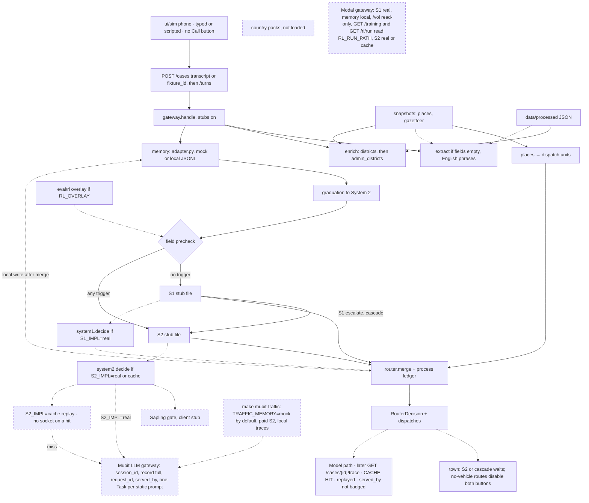
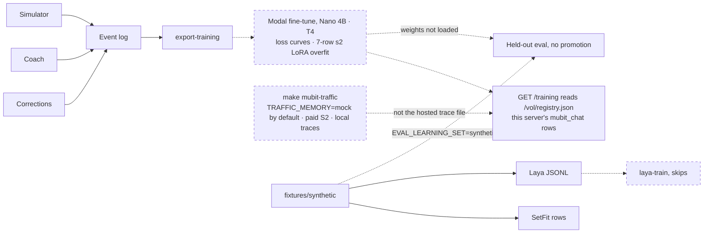
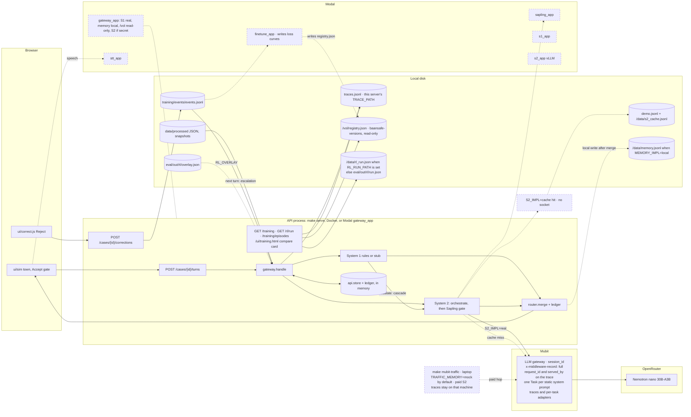

# BaanSafe — Revised Architecture (from Moly, 24 Oct 2026 ~03:00 UK)

This file is the repo copy of that revision. The code follows it. It is not a product decision, and it does not set any value in `config/decisions.yaml`.

Key corrections:

- Mubit Gateway owns: authenticated API gateway, memory retrieval (similar cases, prior failures, policies, corrections), policy and safeguarding checks, routing to System 1 or System 2, tracing/versioning/latency/token/audit, and a validated structured response. Routing mode is `cascade`: a System 1 escalate continues to System 2 in the same turn. Mubit does not reason.
- Memory is BaanSafe's own store behind `memory/adapter.py`. The gateway retrieves from that store and passes the items to whichever system handles the case. `MEMORY_IMPL=local` is append-only JSONL and, after `merge`, writes a case record. The hosted gateway sets that mode and `MEMORY_LOCAL_PATH=/data/memory.jsonl`. Mubit exposes no memory API. The only Mubit edge is the System 2 LLM gateway, its trace record, and per-task adapters.
- System 1 is a separate fast deterministic system (rules, keyword or field extraction, priority rules, simple routing, duplicate checks, fast evidence-gap detection). Its outcome is `fast_route`. It never handles ambiguous or high-risk cases.
- System 2 is a separate deliberative system orchestrated by Nemotron (evidence synthesis, ambiguity, medical dependency, safeguarding, complex routing, aid exceptions, correction proposals and root cause). Its outcome is `reasoned_recommendation`. It never handles routine low-risk cases.
- Nemotron is the System 2 orchestrator. It is not embedded in Mubit. The gateway calls Nemotron through Mubit when System 2 is required. Mubit records the call (`metadata.session_id` is the case id). `llm.client.complete` sends `x-middleware-record: full` on every call (`37e5ab1`; this reverses the earlier never-send rule for that client). The trace note carries `request_id` when Mubit returns `mreq_` plus 32 hex, and `served_by=` when `x-middleware-served-by` names a provider or an adapter. `complete` also stamps `mubit_served_by` on the reply. `llm/openai_client.py` does not add the record header. Never send `x-middleware-store: false` or `x-middleware-record: metadata` or `off`.
- Banyan Sapling (`MubitLabs/banyan-sapling`, Apache-2.0, about 23B stored parameters) verifies System 2 claims after that reasoning and before the Decision Router. It runs only for aid eligibility and denials. System 1 does not call it. The input is a policy, evidence, and a claim, capped at 16,384 tokens. `supported` lets the proposed action stand. `violation` blocks it. `unsure`, `missing` (the checkpoint label `insufficient_information`), and `contradicted` (the checkpoint label `inconsistent_context`) hand the case to a human. The committed client is a stub. Hosting, the 48GB-class GPU, and whether Thai is translated first stay `TODO_HUMAN` in `config/decisions.yaml`.
- The Decision Router merges the deciding outcome (System 2 after a cascade), applies final policy and safeguarding, requires human review when needed, and returns one of `ask_next_question`, `create_provisional_dispatch`, `escalate_to_supervisor`, `finalize_case`, or `request_more_evidence`. `source_outcomes` lists the deciding outcome first, then priors.
- Every System 1 outcome and every System 2 outcome is recorded separately. Humans keep authority over denials, safeguarding exceptions, P1 dispatch, and other irreversible actions. `_post_rules` forces `requires_human` on those P1 outcomes. `merge` still picks `next_action` from the route.

Target flow: Caller → live speech-to-text → Call Agent → Mubit Gateway (memory retrieval, policy pre-check, route) → System 1 (simple, clear, low-risk) or System 2 (ambiguous or high-risk, Nemotron, then Sapling when the claim is aid eligibility or a denial) → Decision Router → Call Agent (next question, update case, or provisional dispatch).

The diagram is `gateway/route.py` on the default request (`use_stubs=True`). Solid edges run. A dashed edge is not taken on that request. After mock memory, `gateway/graduation.py` may tag `complex_situation` and add a `graduated-*` recommendation. That sets no priority and does not move a pattern into System 1. The field precheck in `gateway/chooser.py` picks the system. `router/merge.py` builds the `RouterDecision` and `router/ledger.py` reserves stock in this process only. `load_dispatch_resources` reads `data/snapshots/places.json` on that request and lists public shelters, hospitals, and boat points ahead of the fictional units. Extract, when it runs, reads `data/processed/admin_districts.json` and `districts.json`, then `data/snapshots/gazetteer.json`. Enrichment reads `data/processed` through `ingest/store.py` when `districts.json` is present. `_match_district` tries `districts.json` first, then `admin_districts.json`. Open-Meteo and RID snapshots are the rain and reservoir fallbacks when the matched row has a weather key or a northern province. Every `districts.json` row stores `province` null, so a northern name stops there and `_regional_reservoirs` stays empty for Lampang, Phrae, Nan, and Phayao. Hat Yai and Mueang Songkhla resolve on `admin_districts` as Songkhla Province, and rain stays null on those admin-only matches. Those flags do not change `final_priority`. SQLite is the gitignored `make ingest` cache at `data/raw/ingest.sqlite`. `BAANSAFE_DB_PATH` overrides that cache and is not set on the Modal gateway. GISTDA, TMD, and geoBoundaries stay in `data/snapshots` and are not read on the turn. `countries/` is not imported. `system1/decide.py` runs only when `S1_IMPL=real` or `use_stubs=False`, and then it replaces the stub file. `system2.decide` runs only when `S2_IMPL=real` or `use_stubs=False`. The model id is `nvidia/nemotron-3-nano-30b-a3b`. A local `make serve` defaults to `S1_IMPL=stub` and `S2_IMPL=stub`. The Modal gateway sets `S1_IMPL=real`, leaves `ENRICH_IMPL` empty so enrichment follows `store.available()`, attaches `baansafe-mubit`, and sets `S2_IMPL=real` when both `MUBIT_API_KEY` and `MUBIT_BASE_URL` are present. `apply_runtime_impl` sets `MEMORY_IMPL=local` and `MEMORY_LOCAL_PATH=/data/memory.jsonl` with or without those credentials. A deploy-time `MEMORY_IMPL=mubit` next to the credentials is kept and stays dormant. System 2 is a paid Nemotron call through the Mubit LLM gateway. `llm.complete` sends `metadata.session_id` = `case_id[:200]` and the header `x-middleware-record: full`. The trace note adds `request_id` when the id matches `mreq_` plus 32 hex, and `served_by=` when the served-by header is an allowed token. `complete` stamps `mubit_served_by` on the reply. A cache hit replays the stored id marked `(recorded)` and the stored `served_by`. The orchestrator passes `case_id` on every System 2 hop. Mubit groups those calls into one Task by the static system prompt. Changing that prompt starts a new Task. Mubit exposes no memory API. Without those credentials System 2 stays stub. A local `make serve` stays `MEMORY_IMPL=mock`. The function sets `max_containers=1` and `include_source=True`. `llm.complete` records stage `mubit_chat` and receives `case_id`. `llm/client.py` and `llm/openai_client.py` accept only a Mubit host (`llm.provider_route` is `mubit`, including the compat OpenRouter prefix). `GET /policies` serves the local corpus on its own. Aid routes return 501. Modal model apps refuse to start while their model and GPU values are `TODO_HUMAN`. The gateway app does not. After that response, the page holds a System 2 row or a cascade until Accept or Reject. `information_only` and `duplicate_merge` disable both buttons. `create_provisional_dispatch` does not wait. The gate does not read `requires_human`. The Model Path panel (`ui/sim/modelpath.js`) is a later `GET /cases/{id}/trace` for the last turn, drawn dashed like that hold. `GET /health` includes `memory` `{mode, dormant, warning}`. Startup logs the warning when `MEMORY_IMPL=mubit`. Accept posts `POST /cases/{id}/dispatches/confirm`. Reject posts `POST /cases/{id}/dispatches/cancel`. Either returns 422 when this process has no holds. `GET /resources` subtracts in-process holds. The ledger has already reserved stock at decision time.

Training is a separate path from that call. Operator corrections, coach notes, and simulator outcomes append one `TrainingEvent` each. `make export-training` reads the log. `fixtures/synthetic` is a seeded flood-call set. `training/synthetic_export.py` writes SetFit rows from it (`SYNTHETIC=1` on that make target). `training/laya_export.py` writes Laya JSONL. `scripts/laya_train.py` skips unless `LAYA_TRAIN=1`, a GPU or a Modal task is present, and `laya-train` is on `PATH`. Laya is export-only. `make modal-finetune` is SetFit and LoRA from the event log (`infra/modal/finetune_job.py`). It writes loss curves to `baansafe-versions`. It does not train Laya or read `training/out/laya/`. `modal.finetune_base_model` is `nvidia/Llama-3.1-Nemotron-Nano-4B-v1.1` and `modal.finetune_gpu` is `T4`. `eval/rl/run.py` reports ready only when both are set. System 1 stays rules-only. `HANDOVER.md` records LoRA `ft-20261025T045212Z-8d9937b9` on the 7-row event `s2` set as overfit (loss 14.27 to 0.0017). Private Hub copies under `baansafe` are not served. Held-out eval splits on `group_id` and filters `source`. It scores stub arms and does not load fine-tune weights. `EVAL_LEARNING_SET=synthetic` scores that call set on its committed group split and still does not promote. `make mubit-traffic` (`41413c6`, `TRAFFIC_MEMORY` in `37e5ab1`) calls `gateway.handle` with `use_stubs=False`, `S1_IMPL=real`, `S2_IMPL=real`, and `MEMORY_IMPL` from `TRAFFIC_MEMORY` (default `mock`; `local` puts a seeded store in the prompt). Case ids are `traffic-<seed>-`. `HANDOVER.md` (`30dfa0d`, `daeaad9`) records ~650 requests on 25 Oct, including local batches seed 3 (160 hops) and seed 11 (204 hops). Those traces stay on the machine that ran the command. `GET /training` counts `mubit_chat` in the answering server's `TRACE_PATH` and reads `TRAINING_REGISTRY_PATH` (`/vol/registry.json` on the hosted gateway).

`ui/correct.js` posts a human correction with `task` and `input_ref` already filled. `sim/coach.py` appends `source=coach` and `source=sim`. The log is `training/events` via `training/log.py`. `training/export.py` writes `s1`, `s2`, `sapling`, and `prefs`, each with a manifest. `infra/modal/finetune_job.py` trains `s1_triage` with SetFit and the other tasks with LoRA. `eval/learning` scores held-out groups: arm C keeps `source=human`, and `C_coach` also keeps `source=coach`. Nothing in this path promotes a weight into System 1.

Parallel workstreams during a call feed the gateway: evidence extraction (location, people, danger, medical), policy and safety, BaanSafe memory retrieval, and resource status (boats, ambulances, shelters). Mubit records the System 2 call. It does not serve memory.

## Routing in detail

Checked against `main` on 25 October 2026 (`a3efbcb`). This section says where each step runs: the browser, the API process, Mubit, OpenRouter, Modal, or local disk.

### Where things run

"Mubit Gateway" in the diagrams above is the `gateway/` package. It runs inside the BaanSafe API process, not on Mubit. The Mubit service is the LLM gateway and the trace record. `llm.complete` sends `metadata.session_id` = `case_id[:200]` and `x-middleware-record: full`. The trace note adds `request_id` when Mubit returns `mreq_` plus 32 hex, and `served_by=` from `x-middleware-served-by`. A cache hit appends `(recorded)` and replays the stored `served_by`. Mubit groups that case's calls by session and groups System 2 calls into one Task by the static system prompt. Changing that prompt starts a new Task. Mubit exposes no memory API. Memory is BaanSafe's own store behind `memory/adapter.py`. `GET /health` reports `memory.dormant` when `MEMORY_IMPL=mubit`, and startup logs that warning. The host diagram draws that LLM edge, and a dashed laptop `make mubit-traffic` hop into the same gateway. Memory stays BaanSafe's store. `GET /training` and `GET /rl/run` read `RL_RUN_PATH` (`/data/rl_run.json` on Modal). `GET /training` also reads this server's trace file, the read-only versions volume, the compare of the two committed RL snapshots, and serves `GET /training/episodes`. `finetune_app` writes `registry.json` on that volume. The browser Model Path panel reads `GET /cases/{id}/trace` after the turn.

| Place | What runs there | State it holds |
|---|---|---|
| Browser | `ui/sim/` town and phone, `ui/sim/modelpath.js` Model Path, `ui/correct.js`, `ui/training.html` | None that the backend reads. Model Path reads `GET /cases/{id}/trace`. The training page reads `GET /training` |
| API process (`api/main.py`) | FastAPI routes, `gateway/`, `system1/`, `system2/`, `router/`, `policies/`, `memory/adapter.py`. Mock files unless `MEMORY_IMPL=local` (JSONL) or the dormant `mubit` client. `GET /health` includes `memory` `{mode, dormant, warning}`. Startup logs the warning when dormant | Cases in `api/store.py` and stock holds in `router/ledger.py`, both in memory. Both reset on restart. The Modal gateway pins `max_containers=1` |
| Mubit (`api.mubit.ai`) | The LLM hop at `/compat/openrouter/v1`. `metadata.session_id` is the case id. `llm.client.complete` sends `x-middleware-record: full`. The response header `x-middleware-request-id` is `mreq_` plus 32 hex. `x-middleware-served-by` names the provider or the adapter and is copied onto the trace as `served_by=` and onto the reply as `mubit_served_by`. Traces and per-task adapters stay on that hop. There is no memory API. `llm/client.py` refuses any other host | Mubit-side request traces and per-task adapters. The repo does not read them. The console is the only view of task and adapter status |
| OpenRouter, behind Mubit | `nvidia/nemotron-3-nano-30b-a3b` (`system2.orchestrator_model`). Its provider key is in the Mubit console, not in the repo or Modal | Account credit and the free-tier counter |
| Modal | Six apps in `infra/modal/`. `gateway_app` is the hosted API. It mounts `baansafe-demo` at `/data` and `baansafe-versions` read-only at `/vol`. `HANDOVER.md` records a smoke of that URL. This note did not list Modal apps | Secrets `baansafe-hf` (`HF_TOKEN`) and `baansafe-mubit` (`MUBIT_API_KEY`, `MUBIT_BASE_URL`, and optional `MUBIT_PROJECT_ID` and `S2_SERVE_API_KEY`). The versions volume holds `registry.json` and per-version `metrics.json` |
| Local disk | `traces.jsonl` (`TRACE_PATH`), `training/events/events.jsonl` (`TRAINING_EVENTS_PATH`), the mock corrections JSONL, `MEMORY_LOCAL_PATH` (`var/memory.jsonl`, or `/data/memory.jsonl` on Modal), committed `data/processed` JSON and GeoJSON, `data/snapshots/`, `eval/out/` | Everything that survives a restart. `data/raw/ingest.sqlite` is the gitignored ingest cache. The hosted memory file persists across demo runs |

The API process is the same code in three hosts: `make serve` on a laptop, `docker/Dockerfile` (`make docker-build`), or `infra/modal/gateway_app.py` on Modal. `make serve` and the image default to `S1_IMPL=stub`, `S2_IMPL=stub`, and `MEMORY_IMPL=mock`. The local `.env` sets `S1_IMPL=real`. The Modal gateway sets `S1_IMPL=real`, auto enrichment, and `S2_IMPL=real` when `baansafe-mubit` injects both Mubit values. A deploy-time `S2_IMPL=cache` is kept. `STUB_ENV` sets `S2_CACHE_KEY=case` and `S2_CACHE_RECORD_PATH=/data/s2_cache.jsonl`. `apply_runtime_impl` sets `MEMORY_IMPL=local` and `MEMORY_LOCAL_PATH=/data/memory.jsonl`. That file is BaanSafe's store. Mubit has no memory API. The Modal function mounts `baansafe-versions` read-only at `/vol` and sets `TRAINING_REGISTRY_PATH=/vol/registry.json` and `RL_RUN_PATH=/data/rl_run.json`. `GET /training`, `GET /training/episodes`, and `GET /rl/run` read that RL path. `/ui/training.html` also draws the compare card from the two committed snapshots. `GET /hosting` lists the paths under `reads`. `max_containers=1`. Holds live in that one process and empty after `scaledown_window=120` seconds idle.

### One turn, step by step

Each step names its file and where it runs. Everything runs in the API process unless a step says otherwise.

1. **Phone (browser).** `ui/sim/sim.js` `runPlaceCall` posts `POST /cases` with a transcript for a typed line, and with `fixture_id` for a scripted or saved-prompt household. The Call button (`#phone-record`) is not in `index.html` (`1104248`). Typed messages and saved prompts still send. `toggleRecord` binds only when that control is present. It then posts `POST /cases/{id}/turns` with the same line. A fixture create keeps hand-filled fields, so extract does not rewrite them. A transcript create extracts. The desk reads `decision.dispatches`, `case.resources.location_context`, and `GET /metrics`. The Model Path panel (`ui/sim/modelpath.js`, `#gateway-hop`) then reads `GET /cases/{id}/trace` for the last turn. `trace.read_traces` skips lines that do not contain that case id before parsing. `GET /metrics` still parses every line. A `mubit_chat` row badges `ok` as `live via Mubit` and `cache_hit` as `CACHE HIT · replayed` (`f3954d9`). `request_id` shows only when it matches `mreq_` plus 32 hex. `(recorded)` marks a replayed id. The note can also carry `served_by=`. `parseMubitNote` does not badge that token. Page load draws `ui/sim/hosting_banner.js` from `GET /hosting`, falling back to `GET /health`: System 2 live, cache, or stub, the memory mode, and whether Mubit credentials are present. `GET /` redirects to `/ui/sim/index.html` with status 307 (`795f451`). The About dialog (`ui/sim/about.js`) cites the 2011 floods and a Hat Yai rainfall figure as background. `data.demo_event` stays `Sukhumvit / Watthana (Bangkok)`. `ui/sim/approval.js` holds any `system_2` row or a cascade. `information_only` and `duplicate_merge` disable Accept and Reject. `next_action` `create_provisional_dispatch` does not wait. The function does not read `requires_human`.
2. **Append the turn.** `api/routes/endpoints.py` `add_turn` appends the line to the stored `CaseState` and calls `execute`, which calls `gateway.route.handle(case, use_stubs=True)`.
3. **Extract.** `gateway/route.py` `_extract` runs `system1/extract.py` `extract` when the case has no fields, and again on every later turn once `keyword_extraction` is in `policy_flags`. Fixture cases carry hand-filled fields and are never extracted. Need, danger, and vulnerability phrases are English word-boundary matches. `4913304` removed the Thai phrase lists. Rising water adds `rescue` only when `Need.rescue` is not already in `needs`, so an explicit trapped phrase plus inferred rescue does not become two rescues (`e5a020d`). The district match still reads Thai and English names from `data/processed/admin_districts.json` and `districts.json`, then `data/snapshots/gazetteer.json`.
4. **Enrich.** `enrich/context.py` `location_context` reads `data/processed` through `ingest/store.py` when `ENRICH_IMPL=data`. That is the default once `districts.json` exists. `_match_district` tries `districts` first, then `admin_districts`. A northern name hits `districts.json`, whose `province` is null, so `_regional_reservoirs` stays empty. Hat Yai and Mueang Songkhla resolve on `admin_districts` with Songkhla Province, and rain stays null. The flags never change priority. `disaster_report.json` has no reader on this turn.
5. **Memory.** `memory/adapter.py` `retrieve` on every turn. This is BaanSafe's own store. `MEMORY_IMPL=mock` (the local default) reads `mocks/memory_context/` and does not call `store_record`. `MEMORY_IMPL=local` scores the JSONL at `MEMORY_LOCAL_PATH` and, after `merge`, appends a case record. The turn diagram does not draw a Mubit memory edge. `POST /cases/{id}/corrections` calls `store_correction`. Mock mode appends the corrections JSONL. Local mode appends a `baansafe-correction` row. A failed remote ingest, when that dormant client is on, stays in the local log.
6. **Human-correction escalation.** `gateway/graduation.py` `apply` reads the training event log. The result is cached per log version. When at least `correction_loop.escalation_threshold` (2) distinct cases carry a human `s1_triage` correction with a `graduation_labels` label on this `(needs, vulnerable, danger)` pattern, it adds `complex_situation` and a `graduated-*` correction MemoryItem. It sets no priority.
7. **Choose the entry system.** `gateway/chooser.py` `choose`. Any `route_to_system_2_if_any` trigger in `config/escalation.yaml` sends the case to System 2: medical, oxygen_dependent or immobile, location confidence below 0.7 or missing, a safeguarding, conflicting_evidence, aid_exception, or complex_situation flag, or a rescue, medical, or aid_payment need. With `RL_OVERLAY` set, a demoted coarse signature adds `learned:demoted`. No trigger sends the case to System 1. The gateway trace event records the mode, the system, and the triggers. `gateway/policy.py` `precheck_notes` records `policy precheck: System 2 triggers from config/escalation.yaml evaluated; fired: <list or none>`.
8. **System 1.**
   - With stubs, the stub file for that case id answers. A non-fixture id gets the no-stub fallback (`missing_evidence == ["fixture_stub"]`).
   - With `S1_IMPL=real`, `system1/decide.py` `decide(case, overlay)` runs the needs table (P2–P4, never P1).
   - It escalates when location confidence is below `system_1_min_confidence` (0.80) or a trigger is present, as defence in depth.
   - A graduated narrow signature in the overlay can answer instead, as a learned System 1 rule.
9. **Cascade (at most once per turn).** With `routing.yaml` `mode: cascade`, a System 1 outcome with `escalate=true` runs System 2 in the same turn. System 2 gets the System 1 outcome as `handoff`, plus the overlay's recommendation for the narrow signature. The no-stub fallback never cascades. Nothing loops back to System 1.
10. **System 2.**
    - With stubs, the stub file answers.
    - With `S2_IMPL=real`, `system2/decide.py` calls `system2/orchestrator.py` `orchestrate`. That builds the prompt from the transcript, fields, flags, fired triggers, memory, resource counts, handoff, and recommendation. It calls `llm/client.py` `complete` with `case_id`, which posts to **Mubit** with `metadata.session_id` = `case_id[:200]` and the header `x-middleware-record: full`, and Mubit forwards to **OpenRouter** and Nemotron nano. The call uses `max_tokens` 700, `reasoning` off, temperature 0, seed 7, and a 10 s timeout (`system2.max_latency_ms`). Never send `x-middleware-store: false` or `x-middleware-record: metadata` or `off`. `llm/openai_client.py` does not add the record header. The trace note is `mubit chat host=… status=…`, plus ` request_id=` when the response header matches `mreq_` plus 32 hex, plus ` served_by=` when `x-middleware-served-by` is an allowed token. `complete` stamps `mubit_request_id` and `mubit_served_by` on the reply.
    - With `S2_IMPL=cache`, the same orchestrator uses `system2/cache.py`. A hit replays the reply and traces `mubit_chat` with `host=s2_cache` (`host=s2_cache/case` when `S2_CACHE_KEY=case`) and `status=cache_hit`. It opens no socket. When the stored reply has `mubit_request_id`, the note appends that id and ` (recorded)`. A stored `mubit_served_by` is replayed as `served_by=`. `fixtures/s2_cache/demo.jsonl` predates both fields, so those replies have neither until re-recorded. A miss calls Mubit when both credentials exist and appends the reply to `S2_CACHE_RECORD_PATH`. Without credentials the miss becomes `system2_unavailable`. `case` drops `case_id`, `memory`, and `resources` before hashing. The committed file has 158 replies recorded with `MEMORY_IMPL=mock`.
    - The reply is parsed into `reasoned_recommendation`.
    - A timeout, an HTTP error (429 is named "rate limited"), an empty reply, or a parse failure becomes a `system2_unavailable` escalation. That escalation is P1 for medical, oxygen_dependent, need:rescue, or immobile, and P2 otherwise.
    - `_post_rules` forces `requires_human` on safeguarding and aid cases. If the outcome is still P1 with `requires_human` false, it sets `requires_human` true and appends `P1 requires human sign-off (irreversible dispatch).` Safeguarding and aid return before that note, so the sentence is not appended when they already forced the flag. `merge` `_next_action` does not read `requires_human`. A P1 rescue still fans out a provisional dispatch, and the `RouterDecision` says `requires_human`. The town holds that System 2 vehicle until Accept because any `system_2` row waits. The gate does not read `requires_human`. An ordinary `create_provisional_dispatch` does not wait.
11. **Sapling gate.** `system2/sapling.py` `verify_before_router` runs only on a System 2 outcome whose check is `aid_eligibility` or `denial` (`system2.sapling_scope`). The client is the stub in `mocks/sapling_stub/`. A live Sapling would run on Modal (`sapling_app`) and is blocked by four `sapling.*` decisions.
12. **Decision Router.** `router/merge.py` `merge(case, outcome, notes, resources, prior)` picks the next action, fans out provisional dispatches, and reserves units in `router/ledger.py` (in memory). `duplicate_merge` becomes `finalize_case` and fans out nothing. `load_dispatch_resources` lists the places snapshot before the four fictional units in `mocks/resources.json`. `source_outcomes` is `[deciding, *prior]`. A router trace event is written. `gateway/route.py` `_write_memory` then stores the record when the mode is not `mock` and the outcome is not the no-stub fallback.
13. **Back to the phone (browser).** The `RouterDecision` returns in `TurnResult`. `next_action` `ask_next_question` makes the phone ask `next_question`, and the caller's answer is the next turn. That is the conversation loop.

### The loops

| Loop | Trigger | Path | Where | Closes when |
|---|---|---|---|---|
| L1 Conversation | Every caller line | Steps 1–13, then the next `POST /turns` | Browser, then the API process | `finalize_case`, `escalate_to_supervisor`, or a dispatch |
| L2 Cascade | System 1 `escalate=true` | System 1, then System 2 in the same turn, at most once | API process, plus Mubit and OpenRouter when `S2_IMPL=real` | The same turn |
| L3 Human correction to escalation | Operator Reject in `ui/correct.js` | `POST /cases/{id}/corrections`: `memory.store_correction` (mock JSONL, a `baansafe-correction` row when `MEMORY_IMPL=local`, or a lesson post when `MEMORY_IMPL=mubit`) and `training/log.append_event`. A failed ingest keeps the correction in the local log. On the next turn, step 6 counts the local events | Browser, API process, and local disk | The next turn after the second distinct case. Live, no training |
| L4 RL loop | `make rl-loop` (live) or `make rl-loop-replay` | `eval/rl/run.py` runs authored themes through `gateway.handle(overlay=...)`. The S2 modes are `live` (Mubit, 2/4/8 s 429 backoff, replies cached in `s2_cache.jsonl`) and `replay` (cache only). `eval/rl/reward.py` scores each episode against settled truth. `eval/rl/learner.py` graduates, recommends, and demotes, and the shadow bandit only records. The run writes `overlay.json`, `run.json`, and sim TrainingEvents | Laptop, then Mubit and OpenRouter in live mode | Offline. It reaches the live path only when `RL_OVERLAY` names `overlay.json` |
| L5 Training export to fine-tune | `make export-training` | The event log becomes per-task datasets (`s1`, `s2`, `sapling`, `prefs`). `eval/rl/run.py` reports fine-tune ready only when both `modal.finetune_base_model` and `modal.finetune_gpu` are set. Both are set (`nvidia/Llama-3.1-Nemotron-Nano-4B-v1.1`, `T4`). `infra/modal/finetune_app.py` trains SetFit for `s1_triage` and LoRA for the others and writes loss curves to `baansafe-versions`. `GET /training` reads that registry | Laptop, then Modal | Not closed: no trained weight is loaded into System 1 |
| L6 Caller sim and coach | `make sim-eval` | `sim/env.py` and `sim/coach.py` append `source=sim` and `source=coach` events | Laptop | Feeds L5. The coach source counts in eval arm `C_coach` only |

A pattern's path through the loops: a System 1 under-triage is corrected by a human (L3). From the second distinct case on, that pattern goes to System 2. The RL loop (L4) can demote a coarse pattern to System 2 after one under-triage. It can graduate a narrow pattern into a System 1 rule after `correction_loop.graduation_threshold` (2) matching System 2 decisions, but only for low-confidence handoffs and never for P1 or complex cases. A human escalation (L3) always wins over a learned System 1 rule (L4), because `complex_situation` forces a System 2 entry at step 7, and System 1 never sees the case.

### Modal: what needs it and what it waits on

| App | Needed for | Blocked by | Status |
|---|---|---|---|
| `gateway_app` | A public URL for the town, the API, and `/ui/training.html` | Nothing in git. `make deploy-modal` | Attaches `baansafe-mubit`. `max_containers=1`. `include_source=True`. Sets `S2_IMPL=real` when both Mubit values are present, and keeps a deploy-time `S2_IMPL=cache`. `STUB_ENV` sets `S2_CACHE_KEY=case` and `S2_CACHE_RECORD_PATH=/data/s2_cache.jsonl`. `apply_runtime_impl` sets `MEMORY_IMPL=local` and `MEMORY_LOCAL_PATH=/data/memory.jsonl`. Mounts `baansafe-versions` read-only at `/vol` |
| `sapling_app` | A live Sapling verifier. The 23B checkpoint needs a 48 GB-class GPU, and no hosted API serves it | `sapling.hosting`, `sapling.gpu`, `sapling.model_id`, `sapling.thai_handling` | Refuses. The router uses the stub |
| `finetune_app` | The "correction becomes a model update" beat with real weights (L5) | Nothing in git for the two decided leaves. `.env()` is inside the image | `modal.finetune_base_model` is `nvidia/Llama-3.1-Nemotron-Nano-4B-v1.1` and `modal.finetune_gpu` is `T4`. Loss curves land on `baansafe-versions`. The 7-row `s2` LoRA is overfit. System 1 does not load the weights |
| `stt_app` | Live Thai speech-to-text behind `/stt/transcribe`. `gateway_app` forwards there when `STT_UPSTREAM` is set at deploy time | `modal.stt_model_id`, `modal.stt_gpu` | Refuses. The phone uses typed or scripted lines |
| `s1_app` | A learned System 1 classifier (mDeBERTa or Laya) | `modal.s1_model_id`, `modal.s1_gpu` | Not needed now: `system1.extraction_method` is `rules-only` |
| `s2_app` | Self-hosted Nemotron on vLLM, registered in the Mubit console | `modal.s2_model_id`, `modal.nemotron_size`, `modal.s2_quant`, `modal.s2_gpu` | Not needed now: `system2.hosting` is `openrouter via mubit gateway` |

`s1_app`, `s2_app`, `sapling_app`, and `stt_app` call `.env()` on the image and then `with_repo()`, which adds the local files last (`9a6dfc6`). Modal 1.6 requires that order. `gateway_app` already attaches `mubit_secret()`, promotes System 2 when those credentials exist, and sets `max_containers=1`, so `api.store` and `router/ledger.py` stay in one process until the container scales down. Memory stays BaanSafe's store: `MEMORY_IMPL=local` and `/data/memory.jsonl` on the `baansafe-demo` volume. That file persists across demo runs. `baansafe-versions` is a second mount, read-only, at `/vol`. `GET /training` counts `mubit_chat` rows in this server's trace file. A local `make mubit-traffic` does not appear there until those traces are on `/data/traces.jsonl`.

### Why containerise

- **One runtime everywhere.** `docker/Dockerfile` installs `requirements.txt` on `python:3.12-slim-bookworm` and runs `make serve`. A laptop, a judge's machine, and a CI runner get the same Python, the same dependencies, and the same stub defaults. Modal builds its images the same way (`gateway_app` pip-installs `requirements.txt` and mounts the repo).
- **No secrets in the image.** `.dockerignore` and `gateway_app` both exclude `.env`. Keys arrive at run time from the environment or a Modal secret.
- **GPU work is isolated.** `docker/Dockerfile.gpu` pins CUDA and vLLM to match `s2_app`. The heavy GPU stack stays out of the API image.
- **State is still in the process.** `max_containers=1` keeps cases and stock holds together. They reset when the container restarts, and a confirm after `scaledown_window=120` seconds idle returns 422. A shared database is still `TODO_HUMAN`.

## Responsibility map

| Layer | Owns | Does not own |
|---|---|---|
| Call Agent / Frontend | Call UX, operator controls, live transcript, case view | Policy, memory, orchestration |
| Mubit Gateway | API gateway, memory retrieval, policy, trace, audit, versioning | Reasoning about ambiguous cases |
| System 1 | Fast deterministic triage and routing | Deliberate reasoning, memory synthesis, complex exceptions |
| System 2 | Deliberate reasoning, evidence synthesis, orchestration | Routine low-risk routing |
| Nemotron | System 2 orchestration and reasoning | Being embedded in Mubit |
| Banyan Sapling | Verification of System 2 aid-eligibility and denial claims, with calibrated probabilities | System 1, routine triage, and being the orchestrator |
| Human operator | Final decisions on high-risk, safeguarding, and irreversible actions | Being replaced for routine dispatch acceptance |

## Ontology

Person → Request → Case → Decision → Outcome. Person → Household → Location → Hazard. Request → Evidence. Case → Need / Resource → AidPolicy. Outcome → Failure → Correction → MemoryRecord. BaanSafe's store behind `memory/adapter.py` retrieves that record and, in local mode, writes one after `merge`.

A MemoryRecord describes a case, contains evidence, records the decision, captures the outcome, identifies a failure, and supports a correction. The gateway passes that context to System 1 and System 2. Mubit does not retrieve or write it.

In this repo, `CaseState` is the case and `Need` is the need enum. The other entities are contract models as of v0.2. See `contracts/CONTRACTS.md`.

## Two-person split

Person A is Moly. Person B is Melanie. The working table is `OWNERSHIP.md`.

| Area | A — Moly | B — Melanie |
|---|---|---|
| Call agent | Live call UX, transcript, operator controls, dispatch view | Aid caseworker view, policy dashboard |
| Mubit Gateway | API gateway, routing to System 1 or System 2, trace logging | Memory schemas, retrieval behaviour, correction memory |
| System 1 | Fast triage rules, deterministic routing | Aid eligibility fast checks |
| System 2 | Complex triage and medical reasoning | Exception reasoning, correction proposals, replay, and the Sapling gate (`system2/sapling.py`) |
| Nemotron | System 2 orchestration for response cases | System 2 orchestration for aid and correction cases |
| Evaluation | Triage and dispatch replay | Aid, exclusion, and correction replay |

Positioning: "Mubit is the LLM gateway and the trace record. Memory is BaanSafe's own store. System 1 acts fast. System 2 reasons deeply with Nemotron as its orchestrator. The Decision Router turns their outcomes into one safe next action."

## Hackathon (The Night Shift)

1. All project code is written during the event, from 19:30 Friday. Open-source libraries and your own tooling are fine.
2. Every project routes its LLM calls through Mubit.
3. Two check-ins on Saturday: the first by 12:00, the second between 12:00 and 18:00 Europe/London. Late arrival is allowed until code freeze.

Tracks, as options rather than a selection made here:

- Recurring tasks — show corrections becoming model updates.
- Own your intelligence layer — move a closed-model workload onto a task-adapted open model, and show quality, cost, and latency side by side.
- Fast refresh — model updates that keep pace with changing data.

The top three projects are judged across tracks. Judging is equal weight: use of Mubit (the demo must show a correction turning into a model update); usefulness; technical execution (it works, and it holds up under questions); demo (clear, live, under the time limit).

Event page: https://luma.com/nightshift-london
