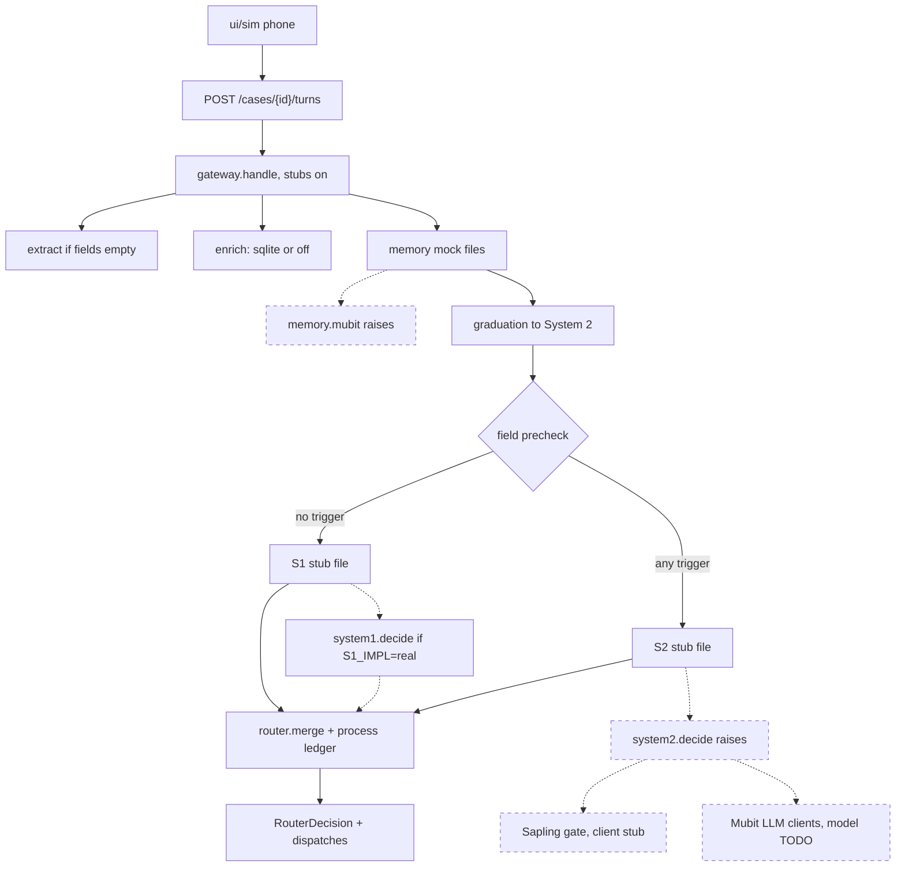
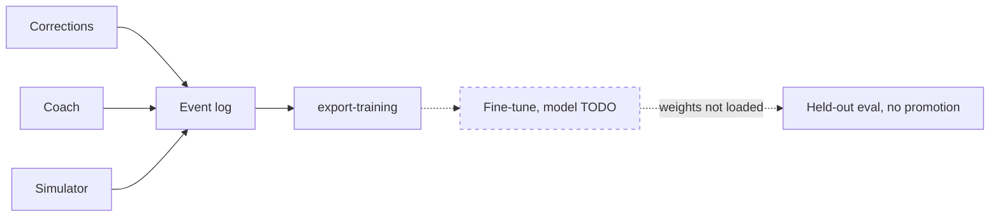

# BaanSafe — Revised Architecture (from Moly, 24 Oct 2026 ~03:00 UK)

This file is the repo copy of that revision. The code follows it. It is not a product decision, and it does not set any value in `config/decisions.yaml`.

Key corrections:

- Mubit Gateway owns: authenticated API gateway, memory retrieval (similar cases, prior failures, policies, corrections), policy and safeguarding checks, routing to System 1 or System 2, tracing/versioning/latency/token/audit, and a validated structured response. Mubit does not reason.
- No separate BaanSafe memory-retrieval service in front of Mubit. The call agent sends the live case to Mubit. Mubit retrieves memory and provides it to whichever system handles the case.
- System 1 is a separate fast deterministic system (rules, keyword or field extraction, priority rules, simple routing, duplicate checks, fast evidence-gap detection). Its outcome is `fast_route`. It never handles ambiguous or high-risk cases.
- System 2 is a separate deliberative system orchestrated by Nemotron (evidence synthesis, ambiguity, medical dependency, safeguarding, complex routing, aid exceptions, correction proposals and root cause). Its outcome is `reasoned_recommendation`. It never handles routine low-risk cases.
- Nemotron is the System 2 orchestrator. It is not embedded in Mubit. Mubit calls Nemotron when System 2 is required. Nemotron returns the result to Mubit for policy validation, tracing, and the memory write.
- Banyan Sapling (`MubitLabs/banyan-sapling`, Apache-2.0, about 23B stored parameters) verifies System 2 claims after that reasoning and before the Decision Router. It runs only for aid eligibility and denials. System 1 does not call it. The input is a policy, evidence, and a claim, capped at 16,384 tokens. `supported` lets the proposed action stand. `violation` blocks it. `unsure`, `missing` (the checkpoint label `insufficient_information`), and `contradicted` (the checkpoint label `inconsistent_context`) hand the case to a human. The committed client is a stub. Hosting, the 48GB-class GPU, and whether Thai is translated first stay `TODO_HUMAN` in `config/decisions.yaml`.
- The Decision Router merges the System 1 or System 2 outcome, applies final policy and safeguarding, requires human review when needed, and returns one of `ask_next_question`, `create_provisional_dispatch`, `escalate_to_supervisor`, `finalize_case`, or `request_more_evidence`.
- Every System 1 outcome and every System 2 outcome is recorded separately. Humans keep authority over denials, safeguarding exceptions, and irreversible actions.

Target flow: Caller → live speech-to-text → Call Agent → Mubit Gateway (memory retrieval, policy pre-check, route) → System 1 (simple, clear, low-risk) or System 2 (ambiguous or high-risk, Nemotron, then Sapling when the claim is aid eligibility or a denial) → Decision Router → Call Agent (next question, update case, or provisional dispatch).

The diagram is `gateway/route.py` on the default request (`use_stubs=True`). Solid edges run. A dashed node is not called on that request. After mock memory, `gateway/graduation.py` may tag `complex_situation` and add a `graduated-*` recommendation. That sets no priority and does not move a pattern into System 1. The field precheck in `gateway/chooser.py` picks the system. `router/merge.py` builds the `RouterDecision` and `router/ledger.py` reserves stock in this process only. `system1/decide.py` runs only when `S1_IMPL=real` or `use_stubs=False`, and then it replaces the stub file. `llm/client.py` and `llm/openai_client.py` accept only a Mubit host (`llm.provider_route` is `mubit`, including the compat OpenRouter prefix). The orchestrator does not reach them while `system2.orchestrator_model` is `TODO_HUMAN`. `GET /policies` serves the local corpus on its own. Aid routes return 501. Modal apps refuse to start while their model and GPU values are `TODO_HUMAN`.

Training is a separate path from that call. Operator corrections, coach notes, and simulator outcomes append one `TrainingEvent` each. `make export-training` reads the log. The fine-tune job takes one dataset per task and does not start while its base model is `TODO_HUMAN`. Held-out eval splits on `group_id` and filters `source`. It scores stub arms and does not load fine-tune weights.

`ui/correct.js` posts a human correction with `task` and `input_ref` already filled. `sim/coach.py` appends `source=coach` and `source=sim`. The log is `training/events` via `training/log.py`. `training/export.py` writes `s1`, `s2`, `sapling`, and `prefs`, each with a manifest. `infra/modal/finetune_job.py` trains `s1_triage` with SetFit and the other tasks with LoRA. `eval/learning` scores held-out groups: arm C keeps `source=human`, and `C_coach` also keeps `source=coach`. Nothing in this path promotes a weight into System 1.

Parallel workstreams during a call feed Mubit: evidence extraction (location, people, danger, medical), policy and safety, Mubit memory retrieval, and resource status (boats, ambulances, shelters).

## Responsibility map

| Layer | Owns | Does not own |
|---|---|---|
| Call Agent / Frontend | Call UX, operator controls, live transcript, case view | Policy, memory, orchestration |
| Mubit Gateway | API gateway, memory retrieval, policy, trace, audit, versioning | Reasoning about ambiguous cases |
| System 1 | Fast deterministic triage and routing | Deliberate reasoning, memory synthesis, complex exceptions |
| System 2 | Deliberate reasoning, evidence synthesis, orchestration | Routine low-risk routing |
| Nemotron | System 2 orchestration and reasoning | Being embedded in Mubit |
| Banyan Sapling | Verification of System 2 aid-eligibility and denial claims, with calibrated probabilities | System 1, routine triage, and being the orchestrator |
| Human operator | Final decisions on high-risk, safeguarding, and irreversible actions | Being replaced for routine dispatch acceptance |

## Ontology

Person → Request → Case → Decision → Outcome. Person → Household → Location → Hazard. Request → Evidence. Case → Need / Resource → AidPolicy. Outcome → Failure → Correction → MemoryRecord, and Mubit retrieves the MemoryRecord.

A MemoryRecord describes a case, contains evidence, records the decision, captures the outcome, identifies a failure, and supports a correction. Mubit retrieves and writes MemoryRecords and provides that context to System 1 and System 2.

In this repo, `CaseState` is the case and `Need` is the need enum. The other entities are contract models as of v0.2. See `contracts/CONTRACTS.md`.

## Two-person split

Person A is Moly. Person B is Melanie. The working table is `OWNERSHIP.md`.

| Area | A — Moly | B — Melanie |
|---|---|---|
| Call agent | Live call UX, transcript, operator controls, dispatch view | Aid caseworker view, policy dashboard |
| Mubit Gateway | API gateway, routing to System 1 or System 2, trace logging | Memory schemas, retrieval behaviour, correction memory |
| System 1 | Fast triage rules, deterministic routing | Aid eligibility fast checks |
| System 2 | Complex triage and medical reasoning | Exception reasoning, correction proposals, replay, and the Sapling gate (`system2/sapling.py`) |
| Nemotron | System 2 orchestration for response cases | System 2 orchestration for aid and correction cases |
| Evaluation | Triage and dispatch replay | Aid, exclusion, and correction replay |

Positioning: "Mubit governs memory, policy, and traceability. System 1 acts fast. System 2 reasons deeply with Nemotron as its orchestrator. The Decision Router turns their outcomes into one safe next action."

## Hackathon (The Night Shift)

1. All project code is written during the event, from 19:30 Friday. Open-source libraries and your own tooling are fine.
2. Every project routes its LLM calls through Mubit.
3. Two check-ins on Saturday: the first by 12:00, the second between 12:00 and 18:00 Europe/London. Late arrival is allowed until code freeze.

Tracks, as options rather than a selection made here:

- Recurring tasks — show corrections becoming model updates.
- Own your intelligence layer — move a closed-model workload onto a task-adapted open model, and show quality, cost, and latency side by side.
- Fast refresh — model updates that keep pace with changing data.

The top three projects are judged across tracks. Judging is equal weight: use of Mubit (the demo must show a correction turning into a model update); usefulness; technical execution (it works, and it holds up under questions); demo (clear, live, under the time limit).

Event page: https://luma.com/nightshift-london
