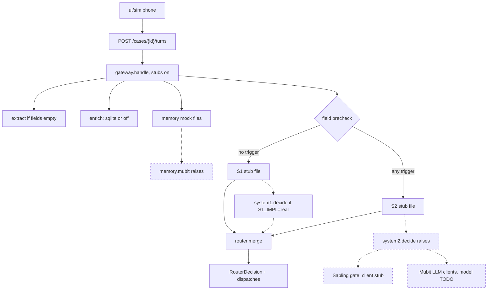

# BaanSafe

Flood and disaster call-triage scaffold. Mubit governs memory, policy, and traceability. System 1 acts fast. System 2 reasons deeply with Nemotron as its orchestrator. On aid-eligibility and denial checks, Banyan Sapling verifies the claim before the decision router. The decision router turns one system's outcome into the next action. Mubit does not reason.

Sapling is [MubitLabs/banyan-sapling](https://huggingface.co/MubitLabs/banyan-sapling), the Apache-2.0 23B verifier (research preview). It takes a policy, evidence, and a claim, and returns `supported`, `violation`, `missing`, `contradicted`, or `unsure`, with probabilities. `supported` lets the proposed action stand. `violation` blocks it. `unsure`, `missing`, and `contradicted` hand the case to a human. The input limit is 16,384 tokens. It does not run on System 1. `system2.use_banyan_sapling` is true for those two checks. Hosting, the GPU, and Thai handling stay `TODO_HUMAN`. Tests use the stub client and do not load a GPU.

Solid edges run on `POST /cases/{id}/turns` with `use_stubs=True`. Dashed nodes are not called on that request. `system1.decide` replaces the stub file only when `S1_IMPL=real` or `use_stubs=False`.



This tree is Phase 0 plus a Phase 1 API. **System 2 decision logic is not implemented. System 1 is rules-only: keyword extraction plus a deterministic needs table.** Callers, households, and transcripts are synthetic. Real district names and public flood polygons are used only to anchor scenarios.

The architecture note is `BaanSafe_Revised_Architecture.md`. What to do in the morning is `MORNING_REPORT.md`. Who owns each folder is `OWNERSHIP.md`. Background reading for Phase 1 is `research/INDEX.md`. The training event schema is `docs/agents/training-schema.md` (listed in `docs/agents/index.json`).

## Setup

Python 3.11 or newer (this environment runs 3.12). From the repo root:

```bash
python3 -m venv .venv
source .venv/bin/activate
pip install -r requirements.txt
```

Optional `.env` values are listed in `.env.example`. None are required for the stub service. Do not commit keys.

## Commands

```bash
make validate       # fixtures, mocks, decisions, personal-data scan
make test           # pytest
make replay-stubs   # accuracy of s1/s2 stub files against expected labels
make demo-stub      # gateway.handle(..., use_stubs=True) for every fixture
make demo-correction-loop  # stub: correction -> JSONL -> model version -> before/after
make eval-learning  # stub: held-out correction eval, writes eval/out/learning.md
make sim-eval       # stub: caller simulator and coach notes, writes eval/out/sim.md
make latte-bench    # third-party latte-bench by reference; skips if bun or the checkout is missing
make serve          # API on :8000, docs at /docs, town sim at /ui/sim/
make ingest         # public sources, using the cache
make ingest-refresh # ignore the cache
make data-report    # rewrite data/SOURCES.md
```

`make` uses `python3` unless you pass `PYTHON=.venv/bin/python`.

The town simulation is static files in `ui/sim/`. `make serve` mounts them at [http://127.0.0.1:8000/ui/sim/](http://127.0.0.1:8000/ui/sim/). It is a fixed isometric view (PixiJS, no GPU vendor requirement). `Play 20 calls` sends each scripted fixture through `POST /triage` and lights the house with the priority the gateway returns. How it sits on the contracts is `ui/sim/README.md`.

## API switches

| Variable | Default tonight | Owner flips to |
|---|---|---|
| `S1_IMPL` | `stub` | `real` runs the rules in `system1/decide.py` |
| `S2_IMPL` | `stub` | `real` when `system2/decide.py` exists |
| `MEMORY_IMPL` | `mock` | `mubit` when `memory/mubit.py` exists |
| `ENRICH_IMPL` | `data` if `data/processed` exists, else `off` | `off` to skip lookups |

`real` returns HTTP 501 (`not implemented yet — owner: …`) for System 2 and `mubit` for memory until that code exists. `S1_IMPL=real` is implemented.

Stub gateway flow for `/triage` and `/cases/{id}/turns`: keyword-extract fields when the case has none (`system1/extract.py`) → enrich → memory through `memory/adapter.py` → route to System 1 **or** System 2 through the field precheck in `gateway/chooser.py` (`gateway.route_chooser` = `field precheck`; never both) → `router/merge.py` turns that one outcome into a `RouterDecision` with `next_action` and provisional dispatches → trace the gateway and the system that ran, with the outcome on the system event. With `use_stubs=True` the selected system's stub outcome stands in for `decide()`; a non-fixture id falls back to a generic escalation outcome.

`GET /aid/eligibility` and `POST /aid/exceptions` return HTTP 501. They do not approve a payment.

LLM calls go through `llm/client.py` / `llm/openai_client.py`. `llm.provider_route` is `mubit`. The OpenAI SDK base is `MUBIT_BASE_URL` (compat OpenRouter prefix) with `MUBIT_API_KEY`. It does not print the key. Chat still needs `system2.orchestrator_model`.

`make demo-correction-loop` runs a synthetic correction through memory, writes an SFT/LoRA JSONL file under `eval/out/` (gitignored), registers stub model versions `stub-0` and `stub-1`, and prints quality, latency, and a null cost. It does not train weights and it does not promote a rule into System 1.

`make eval-learning` writes the held-out stub scoreboard to `eval/out/learning.md`. The same file has an external section that reads [MubitLabs/latte-bench](https://github.com/MubitLabs/latte-bench) when the submodule is checked out. That repository publishes no license. BaanSafe does not vendor its source. `latte_bench.license_confirmation` stays `TODO_HUMAN` until someone confirms the terms with Mubit. Details are in `eval/LATTE.md`. The scoreboard also scores held-out caller trait combinations.

`make sim-eval` runs the scripted caller environment and writes `eval/out/sim.md` plus coach notes at `eval/out/coach.jsonl` (`source=coach`, not promoted). `sim.caller_model` and `sim.caller_gpu` stay `TODO_HUMAN`. The ideas are from MIMESIS ([arXiv:2610.09484](https://huggingface.co/papers/2610.09484)). No paper code is copied. The simulator is not on the live path.

## Data

Public sources and row counts are in `data/SOURCES.md`. Raw responses are gitignored under `data/raw/`. SQLite is the overnight store. The production database is `TODO_HUMAN` in `config/decisions.yaml`.

## Infra

Modal apps live in `infra/modal/`. GPU sizes and the hourly arithmetic are in `infra/HARDWARE.md`. Model ids and GPU names stay `TODO_HUMAN` in git so the apps refuse to start until a human exports them. `make validate` allowlists decided leaves including Sapling on, `sapling.client` `stub`, `system2.hosting` `openrouter via mubit gateway`, and `llm.provider_route` `mubit`. The Nemotron model id and size stay `TODO_HUMAN`. The LLM client still refuses any host that is not Mubit. There is no OpenRouter client.

One-time setup, done by a person:

```bash
modal token new          # once per machine; browser login
# Put HF_TOKEN and MUBIT_API_KEY in gitignored .env (make sync creates .env from .env.example)
make sync                # download: git pull/merge, deps, Modal check, secret sync
make sync SYNC_KEEP=remote   # on conflicts, prefer origin (default is local)
make push                # send: Modal secrets + git push main (syncs first if behind)
make push MSG='summary'  # commit local work (not .env), then push
```

`make sync` / `make push` are the shared teammate path. Sync does not overwrite existing `.env` values. `HF_TOKEN` and `MUBIT_API_KEY` are read from Modal secrets `baansafe-hf` / `baansafe-mubit` after sync. They are not written into the image or the repo. Optional: add `S2_SERVE_API_KEY` to `.env` and re-run `make sync` or `make push`. Paste the same value into the Mubit console as the provider key for the self-hosted OpenAI base URL. The Modal URL is `https://<workspace>--baansafe-s2-serve.modal.run/v1`.

```bash
export S1_GPU=cpu
export S1_MODEL_ID=convaiinnovations/laya-multilingual   # a human picks this
make modal-deploy-s1

export S2_GPU=T4
export S2_MODEL_ID=nvidia/Llama-3.1-Nemotron-Nano-4B-v1.1
export NEMOTRON_SIZE=4B
export S2_QUANT=bf16
make modal-deploy-s2

export FINETUNE_GPU=T4
export FINETUNE_BASE_MODEL=nvidia/Llama-3.1-Nemotron-Nano-4B-v1.1
make demo-correction-loop
make modal-finetune

export STT_GPU=cpu
export STT_MODEL_ID=openai/whisper-large-v3
make modal-deploy-stt

export SAPLING_GPU=L40S
export SAPLING_MODEL_ID=MubitLabs/banyan-sapling
make modal-deploy-sapling
```

The exports above are examples of the variable names. `SAPLING_MODEL_ID` is the published checkpoint. `SAPLING_GPU=L40S` is Modal's 48 GB board; an A6000 is the self-hosted board of the same class and is not a Modal GPU string. `sapling.hosting` is still unset, so the in-process client keeps using the stub until a human confirms that Mubit can route to this endpoint. `infra/HARDWARE.md` is the sizing note. A dry run of the version id, with no GPU and no Modal token, is `python -m infra.modal.finetune_job --dataset eval/out/sft.jsonl` after `FINETUNE_BASE_MODEL` is set.

Local API container (CPU). This is the same process as `make serve`:

```bash
make docker-build
make docker-run          # http://127.0.0.1:8000/health
docker compose up --build
```

`docker/Dockerfile.gpu` matches the System 2 CUDA image. It was not built in the setup pass. A GPU machine runs it with `S2_MODEL_ID`, `NEMOTRON_SIZE`, `S2_QUANT`, and `S2_GPU` set.

## Contracts

`contracts/models.py` is the shared shape. JSON Schema for a UI is in `contracts/schemas/`. Do not edit a contract to suit one system. Propose a change in `contracts/CHANGE_REQUESTS.md`.
