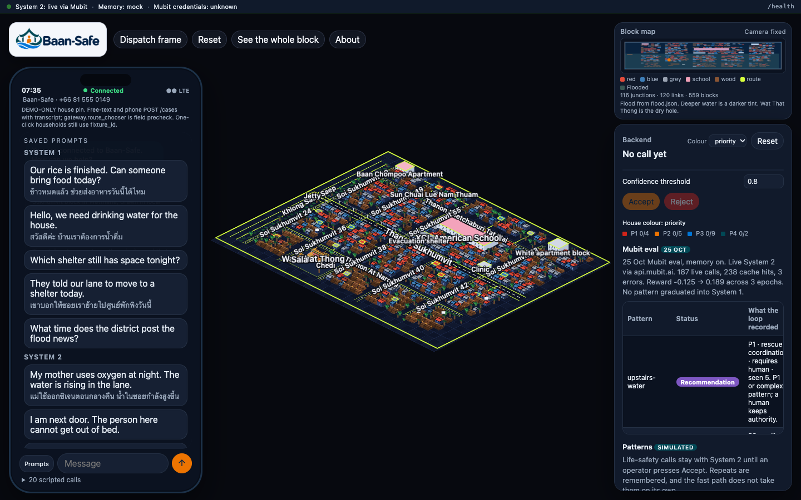
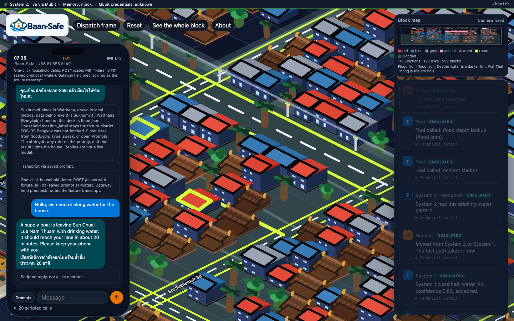
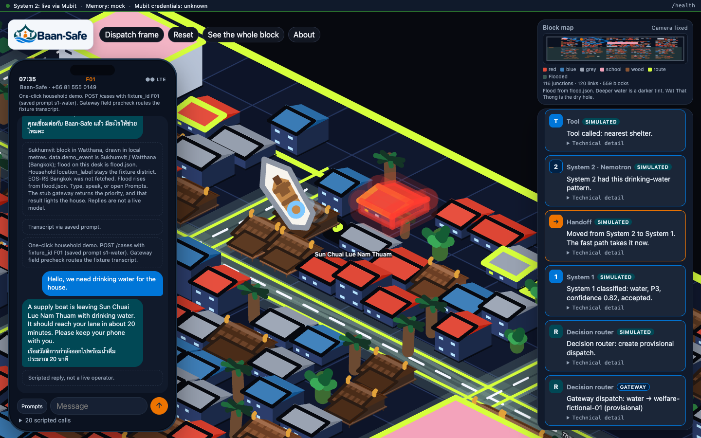
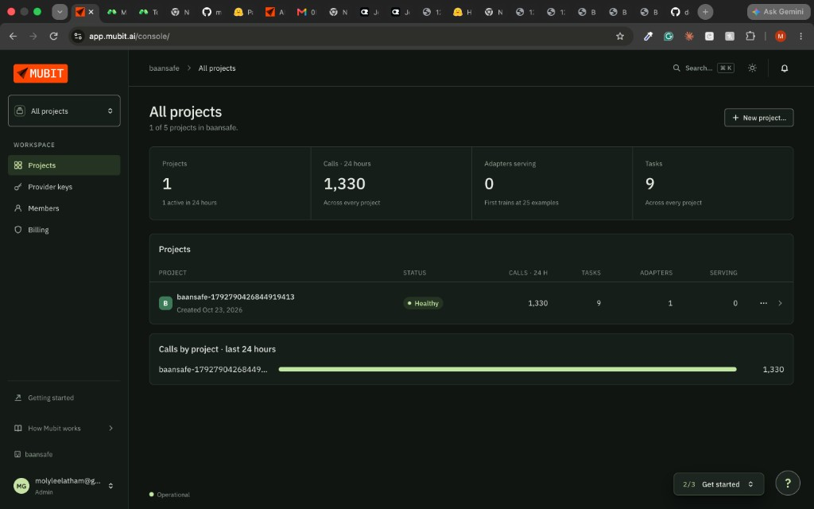
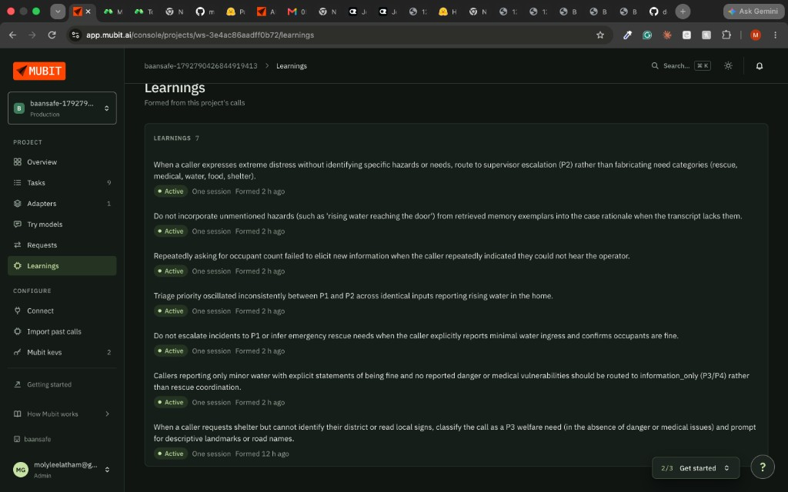
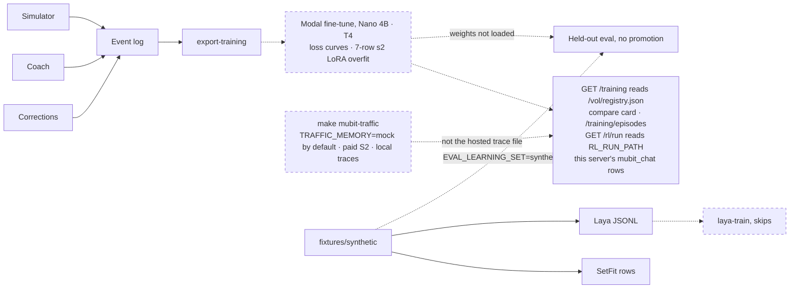

# BaanSafe

## Purpose

**Why.** In a flood, the same hotline hears a family that needs a boat and a household that only needs drinking water, and no desk can sort every call before the water rises. BaanSafe listens, names the need, and puts a life in front of an operator while a routine delivery can leave on its own.

**How.** A field precheck sends ordinary cases down a rules-only fast path and, in the same turn, hands the hard ones to Nemotron through Mubit. Before anyone is told they do not qualify for aid, Banyan Sapling checks the claim against the policy, and the decision router turns the result into a question, a boat or a shelter, or a person who can accept, reject, and correct the call.

**What.** The demo is one screen: a phone, a flooded block of Sukhumvit drawn from public streets and flood data, and the operator's accept or reject. Twenty synthetic households call in, each house takes the priority the gateway returns, and a correction on a rejected call is what the system learns from.

Open the town: [https://baansafe--baansafe-gateway-web.us-east.modal.run/ui/sim/](https://baansafe--baansafe-gateway-web.us-east.modal.run/ui/sim/).



The whole block. The phone has the saved prompts open, including the household that needs drinking water.



The prompt is in progress. Mubit has matched 1 case, and the desk is still moving the call from System 2 to System 1.



The supply boat is deployed from Sun Chuai Lue Nam Thuam.



The baansafe project on Mubit after those calls. 1,330 calls in 24 hours, 9 tasks, one adapter, and the project is healthy.



Mubit formed seven learnings from those calls. They are rules for the System 1 fast path: what it may infer, and what it must not. Distress with no named hazard goes to a supervisor at P2 instead of a guessed need, a hazard that appears only in a past case stays out of the rationale, and minor water with the household fine stays information-only at P3 or P4.

Flood and disaster call-triage scaffold. Mubit is the LLM gateway and trace record: every System 2 call goes through it, is grouped into a task, and can train a per-task adapter. Memory is BaanSafe's own store. System 1 acts fast. System 2 reasons deeply with Nemotron as its orchestrator. On aid-eligibility and denial checks, Banyan Sapling verifies the claim before the decision router. The field precheck picks the entry system; a System 1 escalate cascades to System 2 in the same turn, and the decision router turns the deciding outcome into the next action. Mubit does not reason.

Sapling is [MubitLabs/banyan-sapling](https://huggingface.co/MubitLabs/banyan-sapling), the Apache-2.0 23B verifier (research preview). It takes a policy, evidence, and a claim, and returns `supported`, `violation`, `missing`, `contradicted`, or `unsure`, with probabilities. `supported` lets the proposed action stand. `violation` blocks it. `unsure`, `missing`, and `contradicted` hand the case to a human. The input limit is 16,384 tokens. It does not run on System 1. `system2.use_banyan_sapling` is true for those two checks. Hosting, the GPU, and Thai handling stay `TODO_HUMAN`. Tests use the stub client and do not load a GPU. `infra/modal/sapling_app.py` is the Modal web server (`baansafe-sapling`). `POST /verify` is a Starlette route. The process refuses until `SAPLING_MODEL_ID` and a 48GB-class `SAPLING_GPU` (`L40S`, `A100-80GB`, `H100`, `H100!`, or `H200`) are exported. The default turn still uses the stub.

```mermaid
flowchart TD
  classDef s1 fill:#e3f2e6,stroke:#2e7d32,color:#10261a
  classDef s2 fill:#e4e8f7,stroke:#3949ab,color:#141a3d
  classDef human fill:#fff3cd,stroke:#b8860b,color:#3d2e00
  classDef store fill:#eceff1,stroke:#78909c,color:#263238
  classDef unwired fill:transparent,stroke:#9e9e9e,color:#9e9e9e,stroke-dasharray:5 5

  subgraph L1["1 · Caller — browser, ui/sim phone"]
    stt["Speech to text<br/>browser API · /stt/transcribe not mounted"]:::unwired
    caller["Synthetic caller<br/>typed line or a scripted household<br/>no Call button on the phone"]
  end

  subgraph L2["2 · Mubit gateway — gateway/route.py · routes, traces every stage to traces.jsonl, never reasons"]
    places_db[("districts.json · admin_districts.json<br/>gazetteer snapshot")]:::store
    extract["Extract — system1/extract.py<br/>runs when a case arrives without fields<br/>English needs · people · danger<br/>rising water does not add a second rescue<br/>bare unaccompanied → child unless adult is named<br/>district names in Thai and English"]
    geo_db[("weather_observation.json · flood.geojson<br/>facilities.geojson: 4,218 facilities<br/>Open-Meteo and RID snapshots")]:::store
    enrich["Enrich — enrich/context.py<br/>districts.json first, 50 rows, province null<br/>then admin_districts: Hat Yai · Mueang Songkhla<br/>rain null on admin-only · flags never change priority"]
    memory["Memory — memory/adapter.py<br/>BaanSafe's own store, every turn<br/>mock files by default<br/>local JSONL · write after merge<br/>hosted /data/memory.jsonl<br/>mubit mode dormant · GET /health says so<br/>similar case · correction · policy"]
    grad["Correction escalation — gateway/graduation.py<br/>2 cases with a high-risk human correction on one pattern<br/>tag complex_situation · sets no priority"]
    pick{{"Field precheck — gateway/chooser.py<br/>medical · oxygen or immobile<br/>location below 0.7 · rescue, medical or aid need<br/>safeguarding · conflict · aid exception · complex?"}}
  end

  subgraph L3a["3a · System 1 — fast_route · rules-only"]
    s1["Needs table — system1/decide.py<br/>water, food → welfare point P3<br/>shelter P3 · evacuation → shelter P2<br/>power P3 · information P4 · never P1<br/>open similar case in memory → duplicate merge<br/>escalates below 0.80, on a missing or unknown need, or a trigger"]:::s1
  end

  subgraph L3b["3b · System 2 — reasoned_recommendation"]
    nemo["Nemotron nano 30B-A3B — system2/orchestrator.py<br/>10 s budget · safeguarding, aid, and P1 need a human"]:::s2
    mmem["Mubit — llm/client.py<br/>LLM gateway only<br/>case_id on every System 2 hop<br/>metadata.session_id = case_id<br/>x-middleware-record: full on every call<br/>trace request_id=mreq_… · cache replay (recorded)<br/>served_by= from x-middleware-served-by<br/>provider or adapter · also on the reply<br/>never store false or record metadata or off<br/>one Task per static system prompt<br/>trace record · per-task adapters<br/>no memory API"]:::s2
    cache["S2_IMPL=cache — system2/cache.py<br/>158 replies in fixtures/s2_cache/demo.jsonl<br/>case key drops memory and resources<br/>hit: host=s2_cache, no socket<br/>replayed id marked (recorded)<br/>stored served_by replayed too<br/>demo.jsonl has neither until re-recorded<br/>miss: Mubit, else supervisor fallback"]:::unwired
    down["No usable reply → system2_unavailable<br/>P1 if life-safety, else P2 · human"]:::s2
    sap["Banyan Sapling gate — system2/sapling.py<br/>aid eligibility and denial only<br/>supported stands · violation blocks · else human<br/>stub client on the turn<br/>Modal sapling_app POST /verify<br/>when SAPLING_MODEL_ID and a 48GB GPU are exported<br/>sapling.hosting stays TODO_HUMAN"]:::unwired
  end

  subgraph L4["4 · Decision router — router/merge.py · first match wins"]
    merge{{"Merge the deciding outcome<br/>source_outcomes: deciding, then prior<br/>human if the outcome asks, a supervisor or aid route,<br/>safeguarding, or an unfilled dispatch"}}
    sup["escalate_to_supervisor<br/>supervisor or aid route · safeguarding · escalate"]:::human
    fin["finalize_case<br/>duplicate merge · information only"]
    ask["ask_next_question<br/>missing evidence, a question, or no location"]
    disp["create_provisional_dispatch<br/>one dispatch per need"]
    units[("Places snapshot: shelters, hospitals, boat points<br/>then mocks/resources.json units")]:::store
    fan["rescue → boat · medical → ambulance<br/>water, food → welfare point<br/>shelter, evacuation → shelter<br/>same district first · router/ledger.py<br/>GET /resources subtracts holds · none free → unfilled"]
  end

  subgraph L5["5 · Operator review — browser, ui/sim"]
    hold["Operator Accept / Reject — ui/sim/approval.js<br/>any system_2 row or a cascade waits<br/>information_only and duplicate_merge: buttons off<br/>create_provisional_dispatch does not wait<br/>gate does not read requires_human<br/>confirm or cancel this process's holds<br/>422 when this process has no holds"]:::human
    banner["Hosting banner — ui/sim/hosting_banner.js<br/>page load: GET /hosting and GET /health<br/>source is /hosting when that JSON arrived<br/>System 2 (Nemotron) · case memory<br/>Inference API · Read API ready<br/>dormant memory is the error tone"]
    eval25["Mubit eval — ui/sim/mubit_eval.js<br/>page load: ui/sim/data/mubit_eval.json<br/>25 Oct 0600Z memory-local · does not call Mubit<br/>187 live · 238 cache · 3 errors · cumulative<br/>no pattern graduated into System 1"]
    path["Model path — ui/sim/modelpath.js<br/>GET /cases/{id}/trace, last turn<br/>other case ids skipped before parse<br/>live via Mubit · CACHE HIT · replayed<br/>request_id when it is mreq_ plus 32 hex<br/>note carries served_by= · panel does not badge that"]
    form["Correction form<br/>ui/correct.js"]:::human
  end

  subgraph L6["6 · Learning loops"]
    log[("Training event log<br/>training/events")]:::store
    rl["RL loop — make rl-loop<br/>live and cache hits trace mubit_chat<br/>replay miss → system2_unavailable<br/>make rl-snapshot / rl-restore<br/>copies under eval/snapshots/rl"]
    overlay["Learned overlay<br/>only with RL_OVERLAY"]:::unwired
    ft["Fine-tune on Modal<br/>Nemotron Nano 4B · T4 · both decisions set<br/>loss curves on baansafe-versions<br/>7-row s2 LoRA is overfit<br/>Hub copies private, not served<br/>weights not loaded into System 1"]:::unwired
    page["GET /training · ui/training.html<br/>compare card · GET /training/episodes<br/>Hub (private) links · held-out per-label table<br/>this server's mubit_chat rows<br/>/vol/registry.json · RL_RUN_PATH<br/>GET /rl/run reads that same path"]
    traffic["make mubit-traffic<br/>scripts/mubit_traffic.py<br/>TRAFFIC_MEMORY=mock by default<br/>local puts a seeded store in the prompt<br/>real S1 and S2 · paid Nemotron<br/>case ids traffic-seed- · traces stay local"]:::unwired
  end

  stt -.-> caller
  caller -->|"transcript or fixture_id, then /turns"| extract
  places_db --> extract
  extract --> enrich
  geo_db --> enrich
  enrich --> memory
  memory --> grad --> pick
  merge -.->|"MEMORY_IMPL=local, after merge"| memory
  pick -->|"no trigger"| s1
  pick -->|"any trigger"| nemo
  nemo -.->|"S2_IMPL=real"| mmem
  nemo -.->|"S2_IMPL=cache"| cache
  cache -.->|"miss"| mmem
  s1 -->|"fast_route"| merge
  s1 -->|"escalate · cascade, same turn"| nemo
  nemo --> merge
  nemo -.->|"aid or denial claim"| sap
  sap -.-> merge
  nemo -->|"timeout or error"| down
  down --> merge
  merge --> sup
  merge --> fin
  merge --> ask
  merge --> disp --> fan
  ask -->|"next question, next turn"| caller
  fan --> hold
  fan --> path
  hold -->|"Reject"| form
  form -->|"POST /cases/{id}/corrections"| log
  log -->|"read every turn"| grad
  rl --> overlay
  rl -->|"sim events"| log
  overlay -.->|"demoted pattern"| pick
  overlay -.->|"learned rule"| s1
  log -.->|"make export-training"| ft
  ft -.-> page
  log --> page
  traffic -.->|"opt-in S2 hops"| mmem
  traffic -.->|"local traces only"| page
  units --> fan
```

The diagram follows one caller turn from top to bottom. Solid boxes and edges are implemented. Dashed ones are a stub, opt-in, or not wired. Green is System 1, blue is System 2, and yellow is where a person decides. A local `make serve` defaults to stub files (`S1_IMPL=stub`, `S2_IMPL=stub`, `MEMORY_IMPL=mock`). `S1_IMPL=real` runs the needs table, and `S2_IMPL=real` calls Nemotron through Mubit. `S2_IMPL=cache` is opt-in: a hit replays `fixtures/s2_cache/demo.jsonl` and opens no socket, `S2_CACHE_KEY=case` drops memory and resources from the key, and a miss calls Mubit when credentials exist. That Mubit edge is the LLM gateway only: the orchestrator passes `case_id` on every hop, `metadata.session_id` is that case id, and Mubit groups those calls into one Task by the static system prompt. Changing that prompt starts a new Task. `llm.client.complete` sends `x-middleware-record: full` on every call (`37e5ab1`; this reverses the earlier never-send rule for that client). It never sends `x-middleware-store: false` or `x-middleware-record: metadata` or `off`. `llm/openai_client.py` does not add that header. The trace note carries `request_id=mreq_…`, a cache hit appends `(recorded)`, and `served_by=` names the provider or the adapter (`x-middleware-served-by`, also stamped as `mubit_served_by`). `_post_rules` forces a human on safeguarding, aid, and P1. `GET /health` sets `memory.dormant` when `MEMORY_IMPL=mubit`. The town Model Path panel (`ui/sim/modelpath.js`) reads `GET /cases/{id}/trace` for the last turn. Memory on the turn is BaanSafe's own store behind `memory/adapter.py` (mock files by default). `MEMORY_IMPL=local` is append-only JSONL. The Modal gateway sets that mode and `MEMORY_LOCAL_PATH=/data/memory.jsonl`, and writes a case record after merge. A deploy-time `MEMORY_IMPL=mubit` next to the credentials stays dormant. Mubit exposes no memory API. The Modal gateway runs System 1 rules and auto enrichment, mounts `baansafe-versions` read-only at `/vol`, and sets System 2 live when `baansafe-mubit` is present. It keeps one container (`max_containers=1`). `router/ledger.py` holds stock in that process only. The town gate (`ui/sim/approval.js`) holds any System 2 row or a cascade until Accept or Reject. `information_only` and `duplicate_merge` disable both buttons. `create_provisional_dispatch` does not wait, and the gate does not read `requires_human`. Accept confirms this process's holds and Reject cancels them. A confirm after idle scaledown returns 422. `GET /resources` subtracts the holds. `make mubit-traffic` is opt-in: real System 1 and System 2, `TRAFFIC_MEMORY` default `mock` (`TRAFFIC_MEMORY=local` puts a seeded store in the prompt), paid Nemotron, case ids `traffic-<seed>-`. Those traces stay on the machine that ran it. `GET /training` counts `mubit_chat` in this server's trace file, reads `/vol/registry.json`, and includes the RL compare card and `GET /training/episodes`. `GET /rl/run` reads `RL_RUN_PATH`, the same file (`/data/rl_run.json` on Modal). Country packs are not loaded. Page load also draws the Mubit eval card from the committed file `ui/sim/data/mubit_eval.json` (`ui/sim/mubit_eval.js`). It does not call Mubit. The counts are cumulative from `eval/snapshots/rl/20261025T0600Z-memory-local`: 187 live, 238 cache, 3 errors, and no pattern graduated into System 1. The file-by-file request map is in `BaanSafe_Revised_Architecture.md`.

<!-- Diagram guide for the agent that refreshes this README. This diagram is the model: keep its layout. Keep the numbered subgraphs (1 caller, 2 Mubit gateway with its data inputs, 3a System 1, 3b System 2, 4 decision router with the dispatch list, 5 operator review, 6 learning loops), the colour classes (s1 green, s2 blue, human yellow, store grey, unwired dashed with a transparent fill so it reads in dark mode), hexagons for decisions, data stores beside the step that reads them, and the legend above (solid = implemented, dashed = stub, opt-in, or not wired). Each box names its step, its file, and the rule or numbers it applies. When the code changes, update labels, edges, and status in place, and keep the legend paragraph true. Do not shrink it back to a file-by-file request map. That map lives in BaanSafe_Revised_Architecture.md. -->



The training path is separate. `fixtures/synthetic` feeds a SetFit row export and a Laya JSONL export. `laya-train` skips unless `LAYA_TRAIN=1` and a GPU or Modal task is present. Held-out eval does not load those weights. `EVAL_LEARNING_SET=synthetic` scores the same call set and still does not promote.



This tree is Phase 0 plus a Phase 1 API. **System 2 calls live Nemotron through Mubit; System 1 is rules-only: keyword extraction plus a deterministic needs table.** `make rl-loop` runs the reward-scored learning loop (graduation, recommendations, demotion, shadow bandit) over the cascade. `GET /rl/run` and `GET /training` both read `RL_RUN_PATH` (`/data/rl_run.json` on Modal, otherwise `eval/out/rl/run.json`). `/ui/training.html` shows Mubit traffic, fine-tune versions with loss curves, the memory-off versus memory-on compare card, RL epochs, and a per-episode table. Callers, households, and transcripts are synthetic. Real district names and public flood polygons are used only to anchor scenarios.

The architecture note is `BaanSafe_Revised_Architecture.md`. What to do in the morning is `MORNING_REPORT.md`. Who owns each folder is `OWNERSHIP.md`. Background reading for Phase 1 is `research/INDEX.md`. The training event schema is `docs/agents/training-schema.md` (listed in `docs/agents/index.json`).

## Setup

Python 3.11 or newer (this environment runs 3.12). From the repo root:

```bash
python3 -m venv .venv
source .venv/bin/activate
pip install -r requirements.txt
```

Optional `.env` values are listed in `.env.example`. None are required for the stub service. Do not commit keys. Copy `.env.example` to `.env` for the recommended developer setup (`S1_IMPL=real`, `S2_IMPL=cache`, `MEMORY_IMPL=local`, Mubit key blank); every name the code reads is listed there with a one-line comment, and `tests/test_env_example.py` keeps it complete. `make demo-reset RESET_ARGS=--yes` puts the local demo state (traces, case memory, recorded replies) back to the start of the frozen script; `--hosted` does the same on the Modal volume.

## Commands

```bash
make validate       # fixtures, mocks, decisions, personal-data scan
make test           # pytest
make replay-stubs   # accuracy of s1/s2 stub files against expected labels
make demo-stub      # gateway.handle(..., use_stubs=True) for every fixture
make demo-correction-loop  # stub: correction -> JSONL -> model version -> before/after
make rl-loop        # reward loop with live Nemotron (Mubit env required)
make rl-loop-replay # reward loop replaying the cached System 2 replies
make eval-learning  # stub: held-out correction eval, writes eval/out/learning.md
make sim-eval       # stub: caller simulator and coach notes, writes eval/out/sim.md
make latte-bench    # third-party latte-bench by reference; skips if bun or the checkout is missing
make serve          # API on :8000, docs at /docs, town sim at /ui/sim/, training page at /ui/training.html
make ingest         # public sources, using the cache
make ingest-refresh # ignore the cache
make data-report    # rewrite data/SOURCES.md
```

`make` uses `python3` unless you pass `PYTHON=.venv/bin/python`.

The town simulation is static files in `ui/sim/`. `make serve` mounts them at [http://127.0.0.1:8000/ui/sim/](http://127.0.0.1:8000/ui/sim/). It is a fixed isometric view (PixiJS, no GPU vendor requirement). `Play 20 calls` sends each scripted fixture through `POST /triage` and lights the house with the priority the gateway returns. How it sits on the contracts is `ui/sim/README.md`.

## API switches

| Variable | Default tonight | Owner flips to |
|---|---|---|
| `S1_IMPL` | `stub` | `real` runs the rules in `system1/decide.py` |
| `S2_IMPL` | `stub` | `real` runs the Nemotron orchestrator (`system2.orchestrator_model`) through Mubit on every turn. `cache` replays an exact-key reply from `fixtures/s2_cache/demo.jsonl` (+ `S2_CACHE_RECORD_PATH`) and calls Mubit only on a miss, so a demo survives a Mubit timeout. `S2_CACHE_KEY=case` (hosted) keys on transcript/fields/triggers instead of the whole payload |
| `MEMORY_IMPL` | `mock` | BaanSafe's store in `memory/adapter.py`. `local` is the JSONL store (`memory/local.py`, file at `MEMORY_LOCAL_PATH`, default `var/memory.jsonl`); Modal sets `local` with `/data/memory.jsonl`. `mubit` is dormant: Mubit is not that store |
| `ENRICH_IMPL` | `data` if `data/processed` exists, else `off` | `off` to skip lookups |

`real` on System 2 calls Nemotron through Mubit and returns HTTP 503 when `MUBIT_BASE_URL`/`MUBIT_API_KEY` is unset. That hop sends `metadata.session_id` and is the only Mubit edge. `S1_IMPL=real` is implemented. Memory stays `memory/adapter.py`. Mock reads fixture files and does not write. Local mode appends a case record after `merge`.

Stub gateway flow for `/triage` and `/cases/{id}/turns`: keyword-extract fields when the case has none (`system1/extract.py`) → enrich → memory through `memory/adapter.py` → route to System 1 or System 2 through the field precheck in `gateway/chooser.py` (`gateway.route_chooser` = `field precheck`; `mode: cascade` lets an S1 escalate hand off to S2 in the same turn — the no-stub fallback never cascades) → `router/merge.py` turns that one outcome into a `RouterDecision` with `next_action` and provisional dispatches → when `MEMORY_IMPL` is `local`, append a case record (`memory_write`) → trace enrich, memory, the gateway, and the system that ran, with the outcome on the system event. A Mubit hop also emits `mubit_chat`. With `use_stubs=True` the selected system's stub outcome stands in for `decide()`; a non-fixture id falls back to a generic escalation outcome.

`GET /aid/eligibility` and `POST /aid/exceptions` return HTTP 501. They do not approve a payment.

LLM calls go through `llm/client.py` / `llm/openai_client.py`. `llm.provider_route` is `mubit`. The OpenAI SDK base is `MUBIT_BASE_URL` (compat OpenRouter prefix) with `MUBIT_API_KEY`. It does not print the key. `system2.orchestrator_model` is `nvidia/nemotron-3-nano-30b-a3b` and `system2.max_latency_ms` is 10000.

`make demo-correction-loop` runs a synthetic correction through memory, writes an SFT/LoRA JSONL file under `eval/out/` (gitignored), registers stub model versions `stub-0` and `stub-1`, and prints quality, latency, and a null cost. It does not train weights and it does not promote a rule into System 1.

`make eval-learning` writes the held-out stub scoreboard to `eval/out/learning.md`. The same file has an external section that reads [MubitLabs/latte-bench](https://github.com/MubitLabs/latte-bench) when the submodule is checked out. That repository publishes no license. BaanSafe does not vendor its source. `latte_bench.license_confirmation` stays `TODO_HUMAN` until someone confirms the terms with Mubit. Details are in `eval/LATTE.md`. The scoreboard also scores held-out caller trait combinations.

`make sim-eval` runs the scripted caller environment and writes `eval/out/sim.md` plus coach notes at `eval/out/coach.jsonl` (`source=coach`, not promoted). `sim.caller_model` and `sim.caller_gpu` stay `TODO_HUMAN`. The ideas are from MIMESIS ([arXiv:2610.09484](https://huggingface.co/papers/2610.09484)). No paper code is copied. The simulator is not on the live path.

## Data

Public sources and row counts are in `data/SOURCES.md`. Raw responses are gitignored under `data/raw/`. Committed JSON in `data/processed/` is what the runtime reads; `make ingest` rebuilds it through a gitignored SQLite build cache at `data/raw/ingest.sqlite`. The production database is `TODO_HUMAN` in `config/decisions.yaml`.

## Infra

Modal apps live in `infra/modal/`. GPU sizes and the hourly arithmetic are in `infra/HARDWARE.md`. Most model ids and GPU names stay `TODO_HUMAN` in git so those apps refuse to start until a human exports them. `make validate` allowlists decided leaves including Sapling on, `sapling.client` `stub`, `system2.hosting` `openrouter via mubit gateway`, `llm.provider_route` `mubit`, the Nemotron model id (`nvidia/nemotron-3-nano-30b-a3b`), `system2.max_latency_ms`, `correction_loop.graduation_threshold`, `modal.finetune_base_model` (`nvidia/Llama-3.1-Nemotron-Nano-4B-v1.1`), and `modal.finetune_gpu` (`T4`). The other deploy-time `modal.*` ids stay `TODO_HUMAN`. `s1_app`, `s2_app`, `sapling_app`, and `stt_app` still call `.env()` after `with_repo()`. The LLM client still refuses any host that is not Mubit. There is no OpenRouter client.

One-time setup, done by a person:

```bash
modal token new          # once per machine; browser login
# Put HF_TOKEN and MUBIT_API_KEY in gitignored .env (make sync creates .env from .env.example)
make sync                # download: git pull/merge, deps, Modal check, secret sync
make sync SYNC_KEEP=remote   # on conflicts, prefer origin (default is local)
make push                # send: Modal secrets + git push main (syncs first if behind)
make push MSG='summary'  # commit local work (not .env), then push
```

`make sync` / `make push` are the shared teammate path. Sync does not overwrite existing `.env` values. Sync pushes `HF_TOKEN`, `MUBIT_API_KEY`, and `MUBIT_BASE_URL` from `.env` into Modal secrets `baansafe-hf` / `baansafe-mubit`. Optional `MUBIT_PROJECT_ID` and `S2_SERVE_API_KEY` go into `baansafe-mubit` when they are set. Modal apps read them there. A Modal secret cannot be downloaded, so a teammate who runs System 2 locally still needs the Mubit values in their own `.env`. They are not written into the image or the repo. Optional: add `S2_SERVE_API_KEY` to `.env` and re-run `make sync` or `make push`. Paste the same value into the Mubit console as the provider key for the self-hosted OpenAI base URL. The Modal URL is `https://<workspace>--baansafe-s2-serve.modal.run/v1`.

```bash
export S1_GPU=cpu
export S1_MODEL_ID=convaiinnovations/laya-multilingual   # a human picks this
make modal-deploy-s1

export S2_GPU=T4
export S2_MODEL_ID=nvidia/Llama-3.1-Nemotron-Nano-4B-v1.1
export NEMOTRON_SIZE=4B
export S2_QUANT=bf16
make modal-deploy-s2

export FINETUNE_GPU=T4
export FINETUNE_BASE_MODEL=nvidia/Llama-3.1-Nemotron-Nano-4B-v1.1
make demo-correction-loop
make modal-finetune

export STT_GPU=cpu
export STT_MODEL_ID=openai/whisper-large-v3
make modal-deploy-stt

export SAPLING_GPU=L40S
export SAPLING_MODEL_ID=MubitLabs/banyan-sapling
make modal-deploy-sapling
```

The exports above are examples of the variable names. `SAPLING_MODEL_ID` is the published checkpoint. `SAPLING_GPU=L40S` is Modal's 48 GB board; an A6000 is the self-hosted board of the same class and is not a Modal GPU string. `sapling.hosting` is still unset, so the in-process client keeps using the stub until a human confirms that Mubit can route to this endpoint. `infra/HARDWARE.md` is the sizing note. A dry run of the version id, with no GPU and no Modal token, is `python -m infra.modal.finetune_job --dataset eval/out/sft.jsonl` after `FINETUNE_BASE_MODEL` is set.

### Trained weights

Fine-tune versions live on the `baansafe-versions` Modal volume (`registry.json`, `versions/<id>/{adapter,metrics.json}`) and are listed with loss curves at `GET /training` / `/ui/training.html`. Trained on synthetic callers only. Copies of the 25 Oct runs are on the Hugging Face Hub under the `baansafe` org (private):

| Hub repo | Version | What | Result |
|---|---|---|---|
| [baansafe/baansafe-s1-triage-setfit](https://huggingface.co/baansafe/baansafe-s1-triage-setfit) | `ft-20261025T045101Z-e4ce5eb6` | SetFit on `paraphrase-multilingual-MiniLM-L12-v2`, 168 rows, 16 labels, 20 steps | held-out accuracy 0.875 on 72 rows |
| [baansafe/baansafe-s2-nemotron-nano-4b-lora](https://huggingface.co/baansafe/baansafe-s2-nemotron-nano-4b-lora) | `ft-20261025T045425Z-114efba3` (root) | LoRA r=8 on Nemotron Nano 4B, 36-row RL System 2 set | loss 13.20 → 6.56 |
| same repo, `versions/ft-20261025T045212Z-8d9937b9/` | `ft-20261025T045212Z-8d9937b9` | LoRA r=8, 7-row event-log set | loss 14.27 → 0.0017 (overfit, pipeline demo) |

Each repo carries `training/metrics.json` with the per-step loss. None of these weights is loaded on the live path: System 1 stays rules-only and System 2 is Nemotron through Mubit. Reproduce with `SYNTHETIC=1 make export-training` then `make modal-finetune DATASET=training/out/s1_synthetic.jsonl` (the held-out file next to it is picked up automatically) or `DATASET=eval/out/rl/training/s2.jsonl`; push a new version with `hf upload baansafe/<repo> <adapter dir> .`.

Local API container (CPU). This is the same process as `make serve`:

```bash
make docker-build
make docker-run          # http://127.0.0.1:8000/health
docker compose up --build
```

`docker/Dockerfile.gpu` matches the System 2 CUDA image. It was not built in the setup pass. A GPU machine runs it with `S2_MODEL_ID`, `NEMOTRON_SIZE`, `S2_QUANT`, and `S2_GPU` set.

## Contracts

`contracts/models.py` is the shared shape. JSON Schema for a UI is in `contracts/schemas/`. Do not edit a contract to suit one system. Propose a change in `contracts/CHANGE_REQUESTS.md`.
